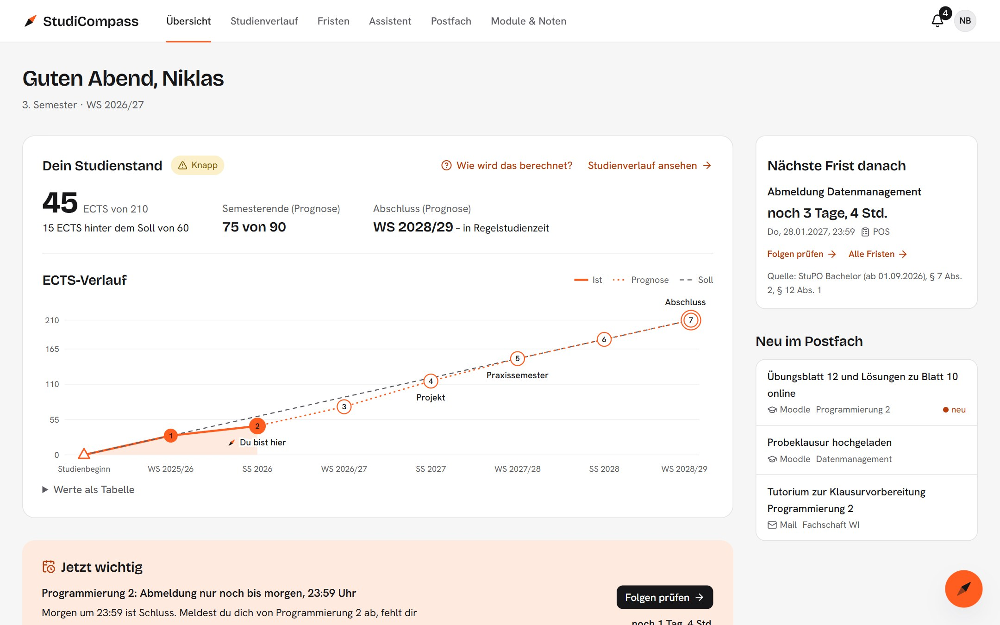
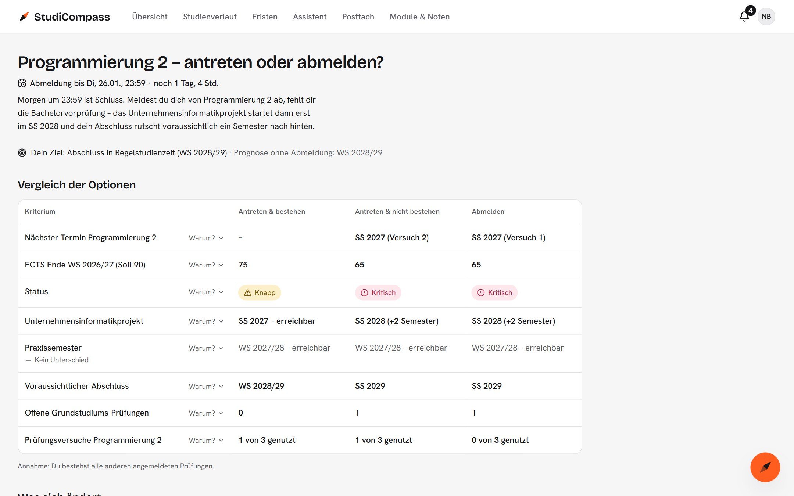
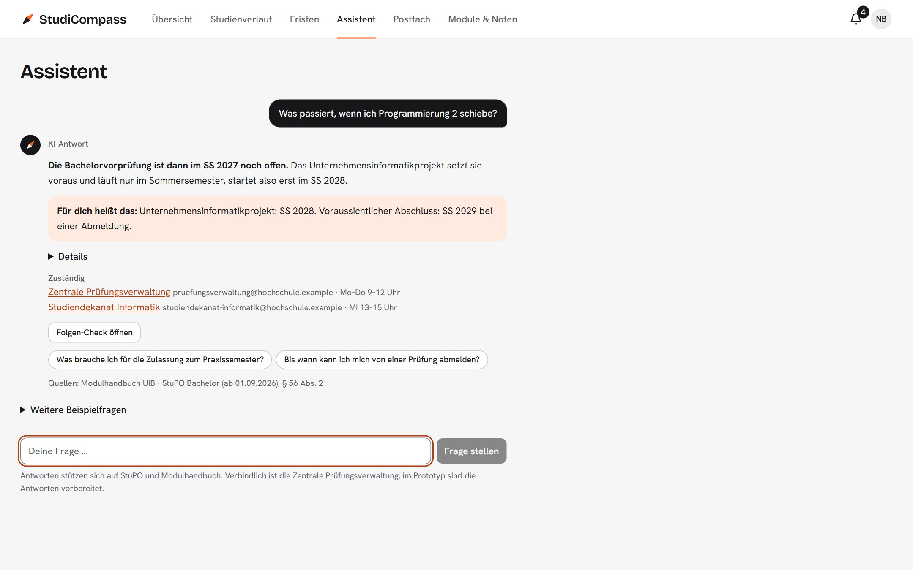

# StudiCompass

**Dein Studium auf einen Blick – und die Folgen deiner Entscheidungen, bevor du sie triffst.**

[](https://github.com/lucasstrubel/studicompass/actions/workflows/check.yml)

**[Live-Demo öffnen](https://studicompass-six.vercel.app)** · [Folien zum Projekt](https://studicompass-six.vercel.app/praesentation/) · [Wie es entstanden ist](docs/PROZESS.md)



StudiCompass ist ein klickbarer Hi-Fi-Prototyp einer Website für Studierende der TH Mannheim. Er bündelt POS, Moodle, Hochschul-Mail und Website, zeigt den eigenen Studienstand und macht sichtbar, was eine Entscheidung wie eine Prüfungsabmeldung für die folgenden Semester bedeutet. Entstanden ist er im Modul Software Engineering 2 an der TH Mannheim (Wintersemester 2026/27); „StudiCompass“ ist ein Arbeitstitel.

## Das Problem

Niklas studiert im 3. Semester Unternehmens- und Wirtschaftsinformatik und arbeitet 15 Stunden pro Woche. Am Abend vor der Abmeldefrist fühlt er sich in Programmierung 2 schlecht vorbereitet und meldet sich ab – das Modul kommt ja nächstes Semester wieder. Was ihm kein System zeigt: Ohne die Prüfung fehlt ihm die Bachelorvorprüfung, das Unternehmensinformatikprojekt setzt sie voraus und läuft nur im Sommer. Sein Abschluss rutscht um ein Semester.

In Interviews und einer Umfrage zeigte sich: Studierende verpassen kaum Fristen. Ihnen fehlt der Überblick über den eigenen Stand und über die Folgen von Sonderregeln.

## Was der Prototyp zeigt

**Folgen-Check.** Vor der Abmeldung stehen „Antreten“ und „Abmelden“ nebeneinander: ECTS, Status, Meilensteine, voraussichtlicher Abschluss. Jede Folge nennt ihre Regel und deren Quelle. Beide Optionen sind gleich gewichtet; die App informiert, sie lenkt nicht. Die Abmeldung ist simuliert und lässt sich rückgängig machen.



**Assistent mit Quellen.** Fragen zur Prüfungsordnung bekommen eine kurze Antwort in Alltagssprache, eine Zeile „Für dich heißt das“ aus dem aktuellen Studienstand, die Quelle und die zuständige Stelle. Gibt es keine eindeutige Regel, sagt der Assistent das und bereitet eine Anfrage vor.



Dazu kommen der Studienverlauf mit Was-wäre-wenn (auch per Drag & Drop), Fristen als Liste und Kalender mit ICS-Export, ein gebündeltes Postfach, Module & Noten sowie ein Onboarding mit Produkt-Tour.

## Was echt ist und was nicht

| Echt                                                                                        | Simuliert oder erfunden                                        |
| ------------------------------------------------------------------------------------------- | -------------------------------------------------------------- |
| Regeln aus der StuPO Bachelor der TH Mannheim (Fassung ab 01.09.2026), jeweils mit Paragraf | Anbindung an POS, Mail und Website (Mock-Services)             |
| Module aus dem [Modulhandbuch UIB](https://module.informatik.th-mannheim.de/UIB)            | Noten, Termine, Mails, Kontaktdaten und die Person Niklas      |
| Berechnung von ECTS, Status, Prognose und Folgen (reine Fachlogik, unit-getestet)           | Der Assistent: vorbereiteter Antwortkatalog, kein Sprachmodell |
| Anbindung an Moodle über dessen Web Services, getestet gegen ein Moodle mit Beispielkursen  | Die Moodle-Daten der Demo, solange du nichts umstellst         |
|                                                                                             | Die Abmeldung: ändert nur den lokalen Zustand, sendet nichts   |

Es gibt kein Backend und keine Anmeldung. Eigene Rechenregeln der App tragen in der Oberfläche das Label „Beispiel“.

**Moodle ausprobieren.** Unter Einstellungen → Moodle-Daten lässt sich der Kanal umstellen: „Aufzeichnung“ zeigt echte Antworten eines Moodle mit Beispielkursen, ohne dass etwas abgerufen wird. „Eigenes Moodle“ verbindet die App direkt mit einem Moodle; dafür gibt es eine [Sandbox für Docker](infra/moodle/README.md). Nur in diesem Modus sendet die App Requests, und nur an dieses Moodle.

## Technik

Vite · React · TypeScript (strict) · React Router · Tailwind CSS · shadcn/ui · Zustand · Recharts · Vitest und Testing Library · Playwright · Deployment auf Vercel.

Die Fachlogik liegt als reines TypeScript in `src/domain/` und ist vollständig unit-getestet. Die Oberfläche liest nur über Store-Selektoren; jeder Kanal hat ein eigenes Service-Interface mit Mock. Mehr dazu in der [technischen Dokumentation](docs/TECHNIK.md).

### Starten

Voraussetzung: Node.js 24 LTS (ab 24.15) oder Node.js 22 (ab 22.22.2).

```sh
npm install
npm run dev
```

Die App läuft dann unter http://localhost:5173. Beim ersten Aufruf öffnet sich das Onboarding; „Demo ohne Einrichtung starten“ überspringt es. Unter Einstellungen lässt sich die Demo zurücksetzen.

### Befehle

| Befehl                 | Zweck                                                                    |
| ---------------------- | ------------------------------------------------------------------------ |
| `npm run dev`          | Entwicklungsserver                                                       |
| `npm run build`        | Produktions-Build nach `dist/` (mit Typprüfung)                          |
| `npm run preview`      | Build lokal ansehen                                                      |
| `npm run lint`         | ESLint                                                                   |
| `npm run typecheck`    | TypeScript-Prüfung (`tsc -b`, ohne Ausgabedateien)                       |
| `npm run test`         | Vitest, einmaliger Lauf                                                  |
| `npm run test:watch`   | Vitest im Watch-Modus                                                    |
| `npm run format`       | Prettier formatiert alle Dateien                                         |
| `npm run format:check` | Prettier prüft die Formatierung                                          |
| `npm run check`        | Prüf-Gate: typecheck, lint, test und build – muss vor jedem PR grün sein |
| `npm run e2e`          | Playwright: Hero-Flow (Desktop und 390 px) gegen den Produktions-Build   |
| `npm run moodle:up`    | Moodle-Sandbox starten (Docker); dazu `moodle:down` und `moodle:reset`   |
| `npm run test:moodle`  | Integrationstests des Moodle-Adapters gegen die Sandbox                  |

`npm run e2e` braucht ein lokal installiertes Google Chrome. GitHub Actions führt `check` und `e2e` bei jedem Pull Request aus.

## Dokumentation

- [Wie es entstanden ist](docs/PROZESS.md): von der Nutzerforschung über Konzept und Prototyp bis zu den Iterationen
- [Technische Dokumentation](docs/TECHNIK.md): Daten und Berechnungen, Design-Tokens, App-Shell, Tests, Deployment
- [Roadmap](docs/ROADMAP.md) und [Architekturentscheidungen](docs/adr/): wie es weitergeht und warum
- [CLAUDE.md](CLAUDE.md): Architektur- und Gestaltungskonventionen, an die sich auch die KI-gestützte Entwicklung hält
- [Präsentationskonzept](docs/praesentation/konzept.md) zu den [Folien](https://studicompass-six.vercel.app/praesentation/)

## Stand

Version [1.0.0](https://github.com/lucasstrubel/studicompass/releases/tag/v1.0.0) ist der Prototyp, wie er im November 2026 als Prüfungsleistung vorgestellt wurde. Getestet hat ihn bisher nur das Projektteam, und alle Hochschulsysteme sind simuliert. Seitdem wird er weiterentwickelt:

- Usability-Test mit Studierenden, die den Prototyp nicht kennen, samt Messung
- Moodle als erste echte Schnittstelle: Änderungen in den Kursen je Modul sehen, Prüfungsvorleistungen planen und verfolgen
- Import der ICS-Dateien in echte Kalender-Apps prüfen

Phasen und Ideen stehen in der [Roadmap](docs/ROADMAP.md), die Entscheidungen dahinter unter [docs/adr/](docs/adr/), die Änderungen im [Changelog](CHANGELOG.md).

## Lizenz und Fremdinhalte

Der Quellcode steht unter der [MIT-Lizenz](LICENSE). Davon ausgenommen sind:

- Regeltexte und Modulangaben, die aus der Studien- und Prüfungsordnung und dem Modulhandbuch der TH Mannheim stammen
- die Folien und Bilder unter `public/praesentation/`
- die Schriften Bricolage Grotesque und Hanken Grotesk (SIL Open Font License 1.1, Lizenztexte unter `public/praesentation/fonts/`)
- reveal.js (MIT, siehe `public/praesentation/vendor/reveal/LICENSE`)

StudiCompass ist ein studentisches Projekt und kein offizielles Angebot der TH Mannheim. Verbindlich sind allein die Dokumente und Auskünfte der Hochschule. Alle personenbezogenen Daten im Prototyp sind erfunden.
