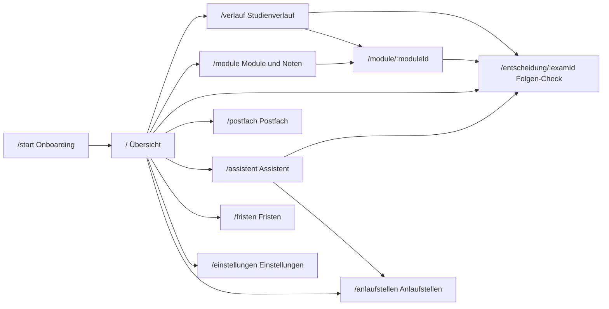
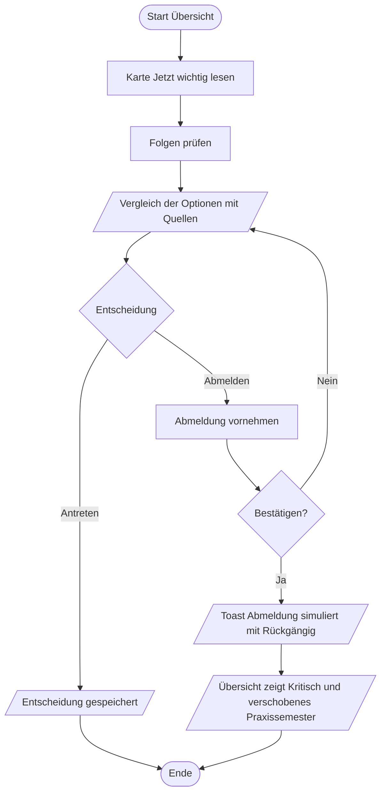

# Konzept – StudiCompass (Hi-Fi-Prototyp, SE2 Studienleistung III)

Stand: 29.10.2026 (Feedback-Runde, P5-08) · Arbeitstitel: **StudiCompass** · Präsentation: **Fr, 06.11.2026**

**Grundlagen:** Vorlesungen 01–05 (SE2, WS 26/27) · Miro-Board „PVL1“ (Persona Niklas Brandt, Value Proposition Map, Exposé, Stakeholder) · Dokument „Erkenntnisse aus der Nutzerforschung“ (5 Interviews, davon 3 mit TH-Studierenden; Umfrage n = 8).

**Status-Kennzeichnung:** `[entschieden]` · `[Vorschlag]` (Team bestätigt in P0-01) · `[Annahme]` (muss geprüft werden)

**Kennungen:** P1–P5 Pains und G1–G4 Gains (wie auf dem Miro-Board) · US-xx User Stories · S0–S9 Screens · DR-x Domänenregeln · Q-x Qualitätsanforderungen · R-x Randbedingungen · T1–T5 Testaufgaben

---

## 1 Ausgangslage: Was die Forschung trägt – und was nicht

| Erkenntnis | Evidenz | Stärke | Konsequenz für den Prototyp |
|---|---|---|---|
| Eigener Studienstand schwer zu überblicken; ECTS selbst rechnen; POS unzuverlässig | I1, I2; U: 4/8 wissen kaum, wie viele ECTS fehlen | **stark** (am besten belegter Pain) | Studienstand ist das Hero-Element der Übersicht |
| Informationen auf vielen Kanälen | täglich Messenger, Mail, Moodle; „stört“ Ø 3,7/5 (WI) | stark | Gebündeltes Postfach mit Kanal-Kennzeichnung |
| Folgen unklar – **nur bei Sonderregeln** (jährliche Module, Zulassung Praxis-/Projektsemester, Übergang Grund-/Hauptstudium); Entscheidung kurzfristig unter Druck | I1; U: 2/7 kennen Voraussetzungen kaum | mittel, gezielt | Folgen-Check mit Warnung nur dort, wo eine Sonderregel greift |
| Kaum Planung über mehrere Semester | U: Ø 2,1/5 | mittel | Studienverlauf zeigt den Plan, ohne Planungsarbeit zu verlangen |
| Antworten in Sonderfällen dauern Tage | I1, I2 | mittel | Assistent mit Quelle; bei Sonderfällen ehrlicher Verweis + vorbereitete Anfrage |
| Fristen verpasst praktisch niemand | U: 8/8 ohne verpasste Frist | **schwach** | Frist als Widget und Liste; Kalender nur als zweite Ansicht der Fristen, nicht auf der Übersicht (Feedback 28.10., P5-08) |
| Vertrauen in KI gespalten | Interviews | – | Jede Antwort mit Quelle; Unsicherheit offen zeigen |
| Organisation meist abends zu Hause am Laptop | U: 8/8 zu Hause, 6/8 Laptop | stark | Desktop-first; Kernflow trotzdem mobil bedienbar |

**Gestaltungsregel daraus `[entschieden]`:** StudiCompass warnt nur, wenn eine Sonderregel greift (Angebot nur einmal im Jahr, Zulassungsvoraussetzung eines Meilensteins, Grenze offener Prüfungen). Pauschale Warnungen bei jeder Abmeldung sind durch die Daten nicht gedeckt und erzeugen Hinweis-Müdigkeit.

**Feedback-Runde 28.10.2026 (P5-08) `[entschieden]`:** Vier Teammitglieder testeten individuell alle Funktionen und notierten anschließend gemeinsam Feedback. Die Sammelliste enthält 23 Punkte (P5-F11 bis P5-F33). Lucas hat den Umsetzungsumfang über ROADMAP P5-09 bis P5-15 freigegeben. [Durchführung und Evidenzgrenzen](evaluation/P5-teamrunde.md), [M5-Abnahme vom 31.10.](abnahmen/M5.md). Wo das frühere Festlegungen ändert, steht der Vermerk „P5-08“ an der Stelle. Persona, Hero-Flow und Testorakel (§10.4) bleiben unverändert, weil alle neuen Eingaben leer starten.

---

## 2 Persona und Nutzungskontext

**Niklas Brandt**, 20, Wirtschaftsinformatik (B. Sc.), TH Mannheim, 3. Fachsemester (Grundstudium), Nebenjob 10–20 Std./Woche, pendelt 30–45 Min.

| Dimension | Für den Prototyp relevant |
|---|---|
| Nutzer [N] | plant semesterweise und kurzfristig; entscheidet unter Zeitdruck eher aus dem Bauch; braucht klare Ansagen; nutzt Kalender-App und KI-Chatbots; vertraut KI eher stark, will aber wissen, wo eine Antwort steht; wenig Datenschutzbedenken, solange DSGVO-konform |
| Aufgaben [A] | Studienstand prüfen · Prüfungen an-/abmelden · Fristen und Änderungen verfolgen · Regeln klären · Semester mit Job planen |
| Umgebung [U] | meist abends zu Hause am Laptop, gezielt am Schreibtisch; Mail/Moodle/Chats mehrmals täglich nebenbei; Ablenkung durch Chats |

**Kritisches Szenario (As-Is, Miro):** Kurz vor der Klausurphase meldet sich Niklas abends spontan von einem schlecht vorbereiteten Modul ab. Dass es nur einmal im Jahr angeboten wird, weiß er grob – was das für die Zulassung zum Praxis- oder Projektsemester bedeutet, zeigt ihm kein System. Wochen später merkt er, dass sein Plan nicht mehr aufgeht.

**To-Be (Prototyp):** Dieselbe Situation – aber StudiCompass zeigt vor der Abmeldung die Folgen mit Quelle. Niklas vergleicht „Antreten“ und „Abmelden“, gleicht das Ergebnis mit seinem Ziel ab und entscheidet bewusst. → Hero-Flow, §9.

---

## 3 Value Proposition → Funktionen (Traceability)

| VPC (Miro) | Pain Reliever / Gain Creator (Miro) | Funktion im Prototyp | Screen | Stories | Test |
|---|---|---|---|---|---|
| P1 Infos auf viele Plattformen verteilt | Bündelt POS, Mail, Moodle & Website | Postfach mit Kanal-Badges, Filter, „Für dich wichtig“; Kanäle verbinden im Onboarding; Kurs-Links und Notizen am Modul (P5-08) | S6, S0, S1, S3 | US-01, US-15, US-16, US-23, US-24 | T4 |
| P2 ECTS selbst ausrechnen, POS unzuverlässig | ECTS-Stand wird automatisch berechnet | Studienstand-Karte (Ist/Soll/Rückstand), Modulübersicht mit Summen | S1, S3 | US-03 | T1 |
| P3 Folgen von Sonderregeln schwer abschätzbar | Folgen-Hinweis vor jeder Abmeldung | Folgen-Check (Vergleich der Optionen), Was-wäre-wenn im Studienverlauf (Menü oder Drag & Drop); Zulassung über Prüfungsvorleistungen (P5-08) | S4, S2, S3 | US-06, US-08, US-10, US-25 | T2, T5 |
| P4 Antworten auf Sonderfragen dauern Tage | Sofort-Antwort mit Quelle und zuständiger Stelle | Assistent; ohne eindeutige Regel: ehrlicher Hinweis + vorbereitete Anfrage an die zuständige Stelle; Anlaufstellen mit Zuständigkeiten (P5-08) | S5, S10 | US-12, US-13, US-28 | T3 |
| P5 Prüfungsordnung schwer verständlich | (wie P4) | Kurzantwort in Alltagssprache + „Warum?“-Erklärung mit Regeltext | S5, S4 | US-12, US-14 | T3 |
| G1 Auf einen Blick: Wo stehe ich? | Ampel Soll/Ist + Countdown zur nächsten Frist | Ampelstatus, Frist-Widget; eigene Termine und Kalenderansicht (P5-08) | S1, S7 | US-03, US-05, US-21, US-22 | T1 |
| G2 Abschluss in Regelstudienzeit | Vorschlag für den Restverlauf | Studienverlauf mit Meilensteinen, zuordenbaren Modulen (P5-08) und Abschlussprognose | S2 | US-04, US-09, US-11, US-26 | T5 |
| G3 Schnelle Antworten, denen man trauen kann | Quelle bei jeder Antwort | Quellenangabe (Dokument, Abschnitt, Stand) an jeder Regelaussage | S5, S4, S2 | US-12, US-14 | T3 |
| G4 Rechtzeitige, ehrliche Hinweise mit Nachdruck | Push-Hinweise mit klarer Ansage | „Jetzt wichtig“-Karte, Benachrichtigungen, wählbarer Hinweis-Stil | S1, S8, S9 | US-07, US-18 | T2 |

Ehrliche Einschränkung zu P4: Echte Sonderfälle stehen per Definition oft nicht eindeutig in der SPO. Der Prototyp verspricht deshalb keine „Sofort-Antwort“ für alles, sondern: Antwort mit Quelle, wo eine Regel existiert – sonst Unsicherheit benennen und den schnellsten Weg zur zuständigen Stelle anbieten.

---

## 4 Prototyp-Strategie

- **Hi-Fi, klickbar** `[entschieden]` – nach VL05: reagiert auf Interaktion, sieht der späteren Anwendung sehr ähnlich, enthält echte Inhalte (keine Bildplatzhalter, kein Lorem Ipsum).
- **Horizontal mit funktionalem Kern** `[entschieden]` – die GUI deckt alle Bereiche in der Breite ab (Fokus Interaktion und Evaluation). Studienstand, Regelprüfung und Folgen-Check rechnen zusätzlich echt auf Dummy-Daten: ein schmaler vertikaler Anteil durch GUI, Anwendungslogik und Daten – ohne Netzwerk und Fremdsysteme.
- **MVP als Querschnitt** `[entschieden]` – lieber den Hero-Flow (§9) vollständig, gut bedienbar und ansprechend als viele halbfertige Screens. Gekürzt wird in der Breite (ROADMAP „Kürzungsliste“), nie im Hero-Flow.

| Bereich | Im Prototyp | Begründung |
|---|---|---|
| Daten aus POS, Moodle, Mail, Website | simuliert: Mock-Services mit Latenz und Kanal-Kennzeichnung | Anbindung technisch und rechtlich ungeklärt (Annahme auf der VPC) |
| ECTS, Soll/Ist, Ampel, Regelprüfung, Prognose | echt berechnet (Domänenlogik, unit-getestet) | Kern des Nutzenversprechens; muss im Test glaubwürdig reagieren |
| KI-Assistent | simuliert: vorbereitete, belegte Antworten + Stichwortzuordnung + ehrlicher Fallback | deterministisch, keine Halluzination in Demo und Test, keine API-Kosten |
| Prüfungsabmeldung | simuliert im Store, rückgängig machbar; Übergabe an das POS nur angedeutet | keine Schreibrechte in Fremdsystemen nötig → geringeres Integrationsrisiko |
| Anmeldung | „Mit Hochschul-Login anmelden (Demo)“ ohne Eingabefelder | keine Zugangsdaten im Prototyp |
| Benachrichtigungen | in der App (Glocke, Toasts), kein Push | reicht zur Demonstration von G4 |
| Zeit | feste Demo-Zeit `DEMO_NOW` = Mo, 25.01.2027, 19:30 | Countdown und Szenario sind in Präsentation und Test stabil |

---

## 5 Scope

### 5.1 Priorisierung (Begriffe aus dem User Story Mapping, VL04) `[entschieden]`

Bestätigt durch die genehmigte Roadmap und Lucas' Vorrangentscheidung vom 30.10.2026; [Entscheidungsabgleich](abnahmen/entscheidungsabgleich.md).

| Priorität | Inhalt | Stories |
|---|---|---|
| **Hoch** | Studienstand mit Ampel und Meilenstein · Folgen-Check inkl. simulierter Abmeldung · Studienverlauf mit Prognose · Assistent mit Quellen und Fallback · Postfach · mobil bedienbarer Kernflow | US-03, US-04, US-06, US-07, US-09, US-12, US-13, US-15, US-20 |
| **Mittel** | Onboarding mit Kanälen · Frist-Widget und Fristenliste · Rückgängig · Was-wäre-wenn · personalisierte Antwortzeile · „Für dich wichtig“ · Hinweis-Stil · seit P5-08: eigene Termine · Prüfungsvorleistung und Zulassung · Module zum Meilenstein · Profil | US-01, US-05, US-08, US-10, US-14, US-16, US-17 (ohne Export), US-18, US-21, US-25, US-26, US-27 |
| **Niedrig** | Ziel und Nebenjob im Onboarding mit Belastungshinweis · Restverlauf-Vorschlag · ICS-Export · Produkt-Tour · Fehler-Simulation je Kanal · ECTS-Verlaufsdiagramm · seit P5-08: Kalenderansicht · Notizen · Kurs-Links · Anlaufstellen · Drag & Drop im Was-wäre-wenn | US-02, US-11, US-17 (Export), US-22, US-23, US-24, US-28 |

### 5.2 Ideenparkplatz (bewusst nicht im Prototyp)

- echte Anbindung von POS, Moodle, Hochschul-Mail und Website
- echtes Sprachmodell mit Retrieval über SPO und Modulhandbuch
- Push-Benachrichtigungen, native App
- Stundenplan, Raumfinder, Mensa
- Lerngruppen und Chat mit Kommiliton:innen
- Lernplan-Generator, Notenprognose
- Mehrsprachigkeit
- Dunkles Design (für die Produktdemo entfernt, Entscheidung von Lucas am 27.10.2026, P5-06; zuvor US-19)
- Sicht für Prüfungsamt/Studienberatung (zweite Persona)
- „Als ungelesen markieren“ in Postfach und Benachrichtigungen; „Alle als gelesen markieren“ mit Rückgängig (P5-07, DP-6)
- Ermutigende Rückmeldung nach „Ich trete an“, z. B. Prüfungstermin und passendes Hilfsangebot – ohne zu lenken (P5-07, DP-10)
- Favicon mit dem Kompass-Logo statt leerem Tab-Symbol (P5-07, DP-8)
- Zweite Demo-Persona im 4. Semester (längerer ECTS-Verlauf, Übergang ins Hauptstudium mit DR-7): Vorschlag aus der Feedback-Runde 28.10.; Niklas bleibt im 3. Semester (Entscheidung von Lucas, P5-08)
- Prüfungsvorleistung mit Wirkung auf die Prognose: Eine nicht erbrachte Vorleistung zählt wie eine Abmeldung (P5-08)
- Meilensteine im Was-wäre-wenn nach hinten verschieben, z. B. für ein Auslandssemester (P5-08)
- Angebundene KI, die ein Anliegen der zuständigen Stelle zuordnet (Feedback 28.10.; im Prototyp über die Seite Anlaufstellen und die Katalogfrage A-09, P5-08)

> Claude Code: Neue Ideen hier als Zeile ergänzen – nicht bauen.

---

## 6 Anforderungen

### 6.1 User Story Map

**Backbone (Whole Story aus Sicht von Niklas):**
1 Einsteigen & Kanäle verbinden → 2 Studienstand erfassen → 3 Entscheidung prüfen → 4 Studium planen → 5 Fragen klären → 6 Informiert bleiben

| ID | Schritt | User Story | Prio | VPC | Akzeptanzkriterien |
|---|---|---|---|---|---|
| US-01 | 1 | Als Niklas möchte ich meine Hochschulkanäle einmalig verbinden, um nicht jede Plattform einzeln öffnen zu müssen. | Mittel | P1 | 4 Kanäle mit Verbindungsstatus; Hinweis „nur Lesezugriff“; überspringbar |
| US-02 | 1 | Als Niklas möchte ich mein Ziel (Regelstudienzeit) und meinen Nebenjob angeben, um passende Hinweise zu bekommen. | Niedrig | G2 | Ziel und Stunden gespeichert; Ziel erscheint im Folgen-Check; Belastungshinweis bei > 36 ECTS |
| US-03 | 2 | Als Niklas möchte ich auf einen Blick sehen, wie viele ECTS ich habe und wie viele mir zum Regelverlauf fehlen, damit ich nicht selbst rechnen muss. | Hoch | P2, G1 | Ist, Soll, Rückstand, Ampel (Icon + Text + Farbe); „Wie wird das berechnet?“ mit DR-1/DR-2; Werte laut §10.4 |
| US-04 | 2 | Als Niklas möchte ich sehen, was mir bis zum Praxissemester noch fehlt, um es ohne Verzögerung zu erreichen. | Hoch | G2, P3 | Meilenstein-Karte mit offenen Modulen, Bedingung und Quelle |
| US-05 | 2 | Als Niklas möchte ich die nächste Frist mit Countdown auf der Startseite sehen. | Mittel | G1 | nächste Frist relativ zu `DEMO_NOW`; Link zur Fristenliste |
| US-06 | 3 | Als Niklas möchte ich vor einer Abmeldung sehen, welche Folgen sie für spätere Semester hat, um nicht unter Druck aus dem Bauch zu entscheiden. | Hoch | P3, G2 | Vergleich laut §8 S4; nächster Termin nach DR-4; Auswirkung auf ECTS, Ampel, Meilensteine, Abschluss; jede Folge mit Regel und Quelle |
| US-07 | 3 | Als Niklas möchte ich bei einer folgenreichen Entscheidung eine klare, ehrliche Ansage bekommen, damit ich sie ernst nehme. | Hoch | G4 | Hinweistext im gewählten Stil; Entscheidung bleibt bei Niklas; beide Optionen visuell gleich gewichtet |
| US-08 | 3 | Als Niklas möchte ich eine (simulierte) Abmeldung rückgängig machen können. | Mittel | – | Bestätigungsdialog; Toast mit „Rückgängig“ (8 s); Zustand überall aktualisiert und wiederherstellbar |
| US-09 | 4 | Als Niklas möchte ich meinen Studienverlauf bis zum Abschluss sehen, um zu erkennen, ob ich in der Regelstudienzeit bleibe. | Hoch | G2 | 7 Semester mit Modulen, Status, ECTS; Meilensteine; Abschlussprognose; seit P5-08: Modulname führt zum Moduldetail, Abgeschlossenes ausblendbar |
| US-10 | 4 | Als Niklas möchte ich ausprobieren, was passiert, wenn ich ein Modul verschiebe. | Mittel | P3 | Verschieben nur in zulässige Semester (DR-4); Neuberechnung; als Simulation gekennzeichnet; verwerfbar; seit P5-08: Ergebnis als Dialog ohne Scrollen, zusätzlich Drag & Drop (Niedrig) |
| US-11 | 4 | Als Niklas möchte ich einen Vorschlag für meinen Restverlauf bekommen. | Niedrig | G2 | Vorschlag, der die Regeln einhält; übernehmbar in die Simulation |
| US-12 | 5 | Als Niklas möchte ich Fragen zur Prüfungsordnung stellen und eine kurze Antwort mit Quelle bekommen, damit ich ihr vertrauen kann. | Hoch | P5, G3 | Antwortkarte laut §11; mind. 8 Fragen abgedeckt; Quelle und zuständige Stelle in jeder Antwort |
| US-13 | 5 | Als Niklas möchte ich erfahren, wenn der Assistent etwas nicht sicher weiß, und direkt an die zuständige Stelle verwiesen werden. | Hoch | P4 | Fallback-Antwort; „Anfrage vorbereiten“ mit kopierbarem Text |
| US-14 | 5 | Als Niklas möchte ich, dass sich Antworten auf meine Situation beziehen. | Mittel | G3 | Zeile „Für dich heißt das: …“ aus aktuellen Daten |
| US-15 | 6 | Als Niklas möchte ich Neuigkeiten aus POS, Moodle, Mail und Website an einem Ort sehen, um nichts zu übersehen. | Hoch | P1 | gemeinsame Liste; Kanal-Badge; Filter; ungelesen-Status; „Im Original öffnen“ (simuliert) |
| US-16 | 6 | Als Niklas möchte ich, dass für mich wichtige Nachrichten hervorgehoben werden. | Mittel | P1 | Abschnitt „Für dich wichtig“ (Prüfung oder Frist in den nächsten 7 Tagen, Meilenstein) mit kurzer Begründung je Eintrag |
| US-17 | 6 | Als Niklas möchte ich alle Fristen in einer Liste sehen und in meinen Kalender übernehmen. | Mittel / Niedrig (Export) | G1 | Liste gruppiert; ICS-Export |
| US-18 | 6 | Als Niklas möchte ich den Ton der Hinweise einstellen (sachlich oder direkt). | Mittel | G4 | Einstellung wirkt auf Übersicht, Folgen-Check, Benachrichtigungen |
| US-19 | – | ~~Als Niklas möchte ich zwischen hellem und dunklem Design wählen.~~ **Gestrichen** (P5-06): für die Produktdemo nur das helle Design, Entscheidung von Lucas am 27.10.2026 | – | – | – |
| US-20 | – | Als Niklas möchte ich den Kernflow auch am Smartphone bedienen können. | Hoch | – | S1 und S4 ab 360 px vollständig bedienbar |
| US-21 | 6 | Als Niklas möchte ich eigene Termine eintragen und bearbeiten, etwa Abgaben für Studienleistungen, damit alle Fristen an einem Ort stehen. | Mittel | G1, P1 | Titel, Datum, optional Uhrzeit, Art, optional Modul; bearbeiten und löschen; nicht vor dem Demo-Datum; erscheint in Fristen, Kalender und „Nächste Frist“ mit Badge „Eigener Eintrag“ (P5-08) |
| US-22 | 6 | Als Niklas möchte ich meine Fristen und Prüfungstermine in einer Monatsansicht sehen. | Niedrig | G1 | Umschalter Liste/Kalender auf der Fristen-Seite; Start im Monat von `DEMO_NOW`; ein ausgewählter Tag zeigt seine Einträge (P5-08) |
| US-23 | 2 | Als Niklas möchte ich mir zu jedem Modul Notizen machen. | Niedrig | P1 | Notizfeld im Moduldetail; speichert lokal; „Demo zurücksetzen“ leert es (P5-08) |
| US-24 | 2 | Als Niklas möchte ich vom Modul direkt zum Moodle-Kurs und zu eigenen Links springen, etwa zur Website der Lehrenden. | Niedrig | P1 | Moodle-Link automatisch (im Prototyp ein Hinweis), eigene Adresse festlegbar; eigene Links nur mit http(s), öffnen in neuem Tab (P5-08) |
| US-25 | 3 | Als Niklas möchte ich die Prüfungsvorleistungen meiner Module eintragen und ihren Stand pflegen, um zu sehen, ob ich zur Prüfung zugelassen bin. | Mittel | P3, G1 | Prüfungsvorleistung mit Stand offen / erbracht / nicht erbracht; Zulassung mit Quelle (DR-13) in Moduldetail, Modulliste, Modulkarten und Folgen-Check; Prognose unverändert (P5-08) |
| US-26 | 4 | Als Niklas möchte ich sehen, welche Module zu einem Meilenstein gehören. | Mittel | G2, P3 | Meilenstein-Chip als Umschalter; markiert die zugehörigen Module mit Icon und Text (DR-6, DR-11, DR-12); Regel mit Quelle (P5-08) |
| US-27 | 1 | Als Niklas möchte ich im Onboarding mein Profil anlegen und es später bearbeiten. | Mittel | – | Vor- und Nachname aus dem POS vorbelegt, im Onboarding und in den Einstellungen änderbar; wirkt auf Begrüßung, Avatar und Anfrage-Entwürfe; keine Login- oder Passwortfelder (P5-08) |
| US-28 | 5 | Als Niklas möchte ich auf einen Blick sehen, welche Stelle wofür zuständig ist. | Niedrig | P4 | Seite Anlaufstellen mit Zuständigkeiten, Kontakt, Sprechzeiten und passenden Fragen; der Assistent verweist darauf (P5-08) |

### 6.2 Qualitätsanforderungen

| ID | Anforderung |
|---|---|
| Q-1 | Effizienz: Studienstand, Ampel und „Jetzt wichtig“ sind bei 1440×900 ohne Scrollen sichtbar. |
| Q-2 | Systemstatus: Simulierte Ladezeiten 300–700 ms; jeder Bereich zeigt währenddessen ein Skeleton; jeder Kanal zeigt „zuletzt aktualisiert“. |
| Q-3 | Vertrauen: 100 % der Assistentenantworten und Folgen enthalten eine Quelle oder den ausdrücklichen Hinweis, dass keine eindeutige Regel gefunden wurde. |
| Q-4 | Barrierearmut: Text ≥ 4,5:1, Bedienelemente und informationstragende Grafiken ≥ 3:1 (§12.2); Status nie nur über Farbe; Kernflow vollständig per Tastatur; sichtbarer Fokus. |
| Q-5 | Responsivität: 360–1920 px ohne horizontales Scrollen. |
| Q-6 | Konsistenz: ausschließlich Design-Tokens; Begriffe laut Glossar (§14). |
| Q-7 | Korrektheit: DR-1 bis DR-9 und alle Szenario-Werte aus §10.4 sind durch Unit-Tests abgedeckt. |

### 6.3 Randbedingungen

| ID | Randbedingung |
|---|---|
| R-1 | Keine echten Schnittstellen; alle Daten sind Dummy-Daten hinter einer Service-Schicht. |
| R-2 | Keine echten personenbezogenen Daten, keine Zugangsdaten, keine Nachbildung der Oberflächen echter Hochschulsysteme. |
| R-3 | Statische Web-App ohne Backend; Deployment auf Vercel. |
| R-4 | Fertig bis Do, 05.11.2026; Präsentation Fr, 06.11.2026. |
| R-5 | UI auf Deutsch (Du-Ansprache); Code, Bezeichner und Commits auf Englisch. |
| R-6 | Datenschutzfreundlich: Schriften lokal eingebunden, keine Tracker oder Analytics. |

---

## 7 Informationsarchitektur und Navigation

| Bereich | Route | In Navigation |
|---|---|---|
| Übersicht | `/` | ja |
| Studienverlauf | `/verlauf` | ja |
| Module & Noten | `/module`, `/module/:moduleId` | ja |
| Postfach | `/postfach` (Detail über `?eintrag=<id>`) | ja |
| Assistent | `/assistent` (optional `?frage=<id oder Freitext>`, `?module=<id>`; bisheriges `?modul=` bleibt kompatibel) | ja |
| Fristen | `/fristen` (Kalender über `?ansicht=kalender`) | ja |
| Anlaufstellen | `/anlaufstellen` (Sprungziel je Stelle `#<id>`) | ja |
| Folgen-Check | `/entscheidung/:examId` | nein (Einstiege siehe unten) |
| Einstellungen | `/einstellungen` (Profil unter `#profil`) | Profilmenü; unter 1280 px auch im Hamburger-Menü |
| Onboarding | `/start` | nein |
| Nicht gefunden | `*` | nein |

**Breakpoints und Navigation (Designrevision P1-07, überarbeitet in P5-06 und P5-08)**
- Desktop ≥ 1280 px: eingerückter App-Rahmen mit 24 px Außenabstand, maximal 1600 px breit, abgerundeten Ecken und dezentem Schatten. Topbar mit Marke, allen Bereichen (Übersicht, Studienverlauf, Module & Noten, Fristen, Postfach, Assistent, Anlaufstellen), Glocke und ganz rechts Profil. Kein Hamburger (P5-08, Feedback 28.10.: Er wiederholte die Topbar); Einstellungen und „Profil bearbeiten“ im Profilmenü. Kein Demo-Datum in der Topbar (P5-06): Das Testszenario nennt den 25. Januar. Hauptbereich plus rechte Spalte 320 px.
- Tablet 768–1279 px: gleicher Rahmen, Navigation über Hamburger; rechte Spalte unter dem Hauptbereich.
- Mobil < 768 px: bildschirmfüllend, einzeilige Topbar mit Hamburger, Marke, Glocke und Profil; keine untere Tab-Leiste.
- Unter 1280 px stehen alle Bereiche einschließlich Assistent, Fristen, Anlaufstellen und Einstellungen in einem 280 px breiten hellen Panel direkt unter dem Hamburger: weiße Fläche, rundum abgerundet, feiner Rahmen, weicher Schatten. Die Seite dahinter bleibt sichtbar und scharf (kein Abdunkeln, keine Unschärfe). Keine permanente Sidebar, keine Verschiebung des Inhalts. Aktiver Link mit Fläche `--muted`, Fettung und Icon in Terrakotta.
- Maus mit Hover-Unterstützung: nach 150 ms Vorschau öffnen; beim Wechsel zwischen Trigger und Menü offen halten; nach 250 ms außerhalb schließen, sofern kein Tastaturfokus darin liegt. Klick fixiert dasselbe Panel als Radix-Dialog; Touch und Tastatur öffnen explizit. Schließen über Trigger/Schließen, Außenklick, Escape oder Navigation; explizites Menü mit Fokusführung und Fokusrückgabe. Routenwechsel schließt auch die Vorschau.
- Ein semantischer Seitentitel im Inhaltsbereich. Bestehende Routen bleiben unverändert. Nur helles Design (P5-06).
- **Assistent-Button** (P5-06, P5-07): runder Terrakotta-Button unten rechts auf jeder Seite der App außer `/assistent`. Eine Sprechblase stellt ihn einmal je Demo-Stand vor („Hallo Niklas! Fragen zur Prüfungsordnung? Ich antworte mit Quelle.“), also beim ersten Aufruf nach dem Onboarding bzw. nach „Demo zurücksetzen“; vor abgeschlossenem Onboarding (etwa bei einem Deep-Link) erscheint sie nicht. Sie verschwindet beim Schließen, beim Öffnen des Assistenten, beim ersten Scrollen (mehr als 40 px) oder beim ersten Seitenwechsel. Schon das Anzeigen zählt: Nach Neuladen erscheint sie nicht wieder. So verdeckt sie keine Inhalte, sobald man arbeitet (P5-07). Der Button öffnet das Assistent-Fenster (§8 S5). Toasts und das Seitenende halten Abstand zum Button.

**Einstiege in den Folgen-Check:** „Jetzt wichtig“-Karte (S1) · Modulkarte und Moduldetail (S1, S3) · Benachrichtigung (S8) · Assistentenantwort (S5) · Studienverlauf (S2)



---

## 8 Screens

Jeder Screen hat Lade-, Leer- und Fehlerzustand. Werte in Beispielen entsprechen §10.4.

### S0 Onboarding `/start` (US-01, US-02, US-18, US-27)
1. **Willkommen:** Name/Logo, Nutzenversprechen in einem Satz („Dein Studium auf einen Blick – und die Folgen deiner Entscheidungen, bevor du sie triffst.“), Button „Mit Hochschul-Login anmelden (Demo)“, Link „Demo ohne Einrichtung starten“.
2. **Kanäle verbinden:** vier Karten (POS, Moodle, Hochschul-Mail, TH-Website) mit Schalter → kurze Verbindungsanimation → „verbunden“. Hinweis: „StudiCompass liest nur. Änderungen machst du weiterhin in den Originalsystemen.“ + Datenschutz-Kurzinfo.
3. **Dein Profil** (bis P5-08 „Dein Studium“; Feedback 28.10.: „Benutzer anlegen“): Vorname und Nachname, aus dem POS vorbelegt und änderbar (Pflicht, höchstens 40 Zeichen; keine E-Mail-, Login- oder Passwortfelder); aus dem POS übernommene Werte zur Bestätigung (Studiengang, SPO-Version, Fachsemester); Ziel „Abschluss in Regelstudienzeit“ (an); Nebenjob in Std./Woche (Slider, 15).
4. **Hinweis-Stil:** „Sachlich“ oder „Direkt“, je mit Beispieltext.
- Fortschritt 1/4 … 4/4, Zurück jederzeit, Überspringen. Seit P5-08 behält „Überspringen“ ab Schritt 2 die bisherigen Eingaben (Befund P5-F08); nur „Demo ohne Einrichtung starten“ in Schritt 1 nimmt die Standardwerte.
- Danach Übersicht; Produkt-Tour mit 3 Schritten (Studienstand → Jetzt wichtig → Assistent), seit P5-08 standardmäßig angehakt, abwählbar und abbrechbar. „Demo ohne Einrichtung starten“ startet ohne Tour (Testplan).

### S1 Übersicht `/` (US-03, US-04, US-05, US-07, US-15)
**Kopf:** „Guten Abend, Niklas“ · Chip „3. Semester · WS 2026/27“; Glocke mit Zähler und Profil-Menü in der Topbar.

**Hauptspalte** (Reihenfolge = Priorität; den ECTS-Verlauf hat Lucas in P5-06 direkt unter die erste Reihe gesetzt):
1. **Studienstand** (Hero): „48 ECTS“ groß, „von 210“; Fortschrittsbalken mit Soll-Markierung bei 60; Ampel „Knapp“ + „12 ECTS hinter dem Regelverlauf (Soll nach 2 Semestern: 60)“; Prognose „Ende dieses Semesters: 78 von 90 – wenn du alle angemeldeten Prüfungen bestehst“; Link „Wie wird das berechnet?“ (Popover mit DR-1, DR-2); Button „Studienverlauf ansehen“.
2. **Jetzt wichtig** (zart getönte Karte `--accent-soft` mit Terrakotta-Kante links, Text in Tinte; höchstens 2 Einträge, nur bei Sonderregel): „Statistik: Abmeldung nur noch bis morgen, 23:59 Uhr“ · Folge in einem Satz (Text je Hinweis-Stil, §12.5) · Countdown · Button „Folgen prüfen“ → S4.
3. *(Niedrig)* **ECTS-Verlauf** in voller Breite: Flächendiagramm Ist vs. Soll je Semester ab dem Punkt „Studienbeginn“ mit 0 ECTS (P5-08), das laufende Semester als Prognose (blau wie der Studienstand-Balken, §12.2). Beim Überfahren zeigt ein Tooltip Ist bzw. Prognose, Soll und Differenz, z. B. „12 ECTS unter Soll“ (P5-08). Ab 1280 px steht rechts daneben die Wertetabelle mit Spalte Differenz.
4. **Dieses Semester (WS 2026/27):** fünf Modulkarten im Raster (wie Referenz 1), jede in ihrer Modulfarbe (Illustration, Moodle-Balken; §12.2): Titel, Prüfungstermin, Status „Angemeldet“, Moodle-Fortschritt (z. B. „Übungsblätter 5/12“), Label „nur im WS“ bei jährlichem Angebot, Link zum Moduldetail; sobald eine Prüfungsvorleistung eingetragen ist, auch die Zulassung (S3, P5-08).
5. **Nächster Meilenstein:** „Praxissemester · WS 2027/28“ · Bedingung (DR-6) mit Quelle · „Noch offen: 7 Module des Grundstudiums (5 davon in diesem Semester angemeldet)“ · „Erreichbar, wenn du Programmieren 2 und Wirtschaftsprivatrecht im SS 2027 bestehst“.

**Rechte Spalte:** Nächste Frist mit Countdown (seit P5-08 auch eigene Termine mit Badge „Eigener Eintrag“) · Neu im Postfach (3 relevante Einträge mit Kanal-Badge) · Letzte Noten (3 Einträge mit Noten-Badge, wie Referenz 1) · „Frag den Assistenten“ (Eingabefeld + 2 Vorschlagsfragen).

**Mobil:** Studienstand → Jetzt wichtig → Nächste Frist → ECTS-Verlauf → Dieses Semester → Meilenstein → Rest.

### S2 Studienverlauf `/verlauf` (US-04, US-09, US-10, US-11, US-26)
- **Kopf:** Abschlussprognose („Voraussichtlicher Abschluss: WS 2028/29 – in Regelstudienzeit“) + Ampel + Ziel aus dem Onboarding.
- **Zeitleiste** Semester 1–7 (Desktop: Spalten; mobil: Liste): Term, Fachsemester, ECTS-Summe (geplant/erreicht), Modul-Boxen mit Status (Icon + Text), Angebots-Label (WS/SS/jedes Semester); *(Niedrig)* Belastungshinweis > 36 ECTS. Seit P5-08 führt der Modulname zum Moduldetail (S3), auch in der Simulation. Die Spalten haben ab 1280 px eine Mindestbreite von 11rem; reicht der Platz nicht, etwa nach Verschiebungen, scrollt nur die Zeitleiste horizontal (Feedback 28.10.: „Wenn Boxen verschoben werden, bricht alles“).
- **Abgeschlossenes ausblenden** (P5-08): Ein Schalter blendet vergangene Semester aus, in denen alle Module bestanden sind, und in den übrigen Semestern die bestandenen Module; Hinweis „n Semester ausgeblendet“. Die Einstellung wird gespeichert.
- **Meilensteine** als Marker: Grenze Grund-/Hauptstudium, Praxissemester (5), Projektsemester (6), Bachelorarbeit (7). Seit P5-08:
  - Der Marker ist ein Chip mit Flagge und Text in Violett (§12.2).
  - Ein Klick schaltet die Markierung der zugehörigen Module um (`aria-pressed`): Ende Grundstudium → Module des Grundstudiums (Studienverlaufsplan); Praxissemester → Module des Grundstudiums (DR-6); Projektsemester → Praxissemester (DR-11); Bachelorarbeit → Praxis- und Projektsemester (DR-12).
  - Markierte Module tragen Flaggen-Icon und Text („für Praxissemester“), offene zusätzlich „noch offen“. Die Regel steht mit Quelle darunter.
  - Die Meilenstein-Boxen selbst sind fest: Schloss-Icon, „Fester Meilenstein“ und ein Satz, wovon sie abhängen, mit Quelle (Feedback 28.10.: „Praxissemester ist nicht verschiebbar“).
- **Was-wäre-wenn** *(Mittel)*: Schalter „Simulation“; Menü „Verschieben nach …“ an jedem offenen Modul (nur zulässige Terms laut DR-4); Neuberechnung; geänderte Elemente hervorgehoben; durchgehend als Simulation gekennzeichnet. Seit P5-08:
  - Nach jeder Verschiebung öffnet ein Ergebnis-Dialog (Feedback 28.10.: Scrollen war ungünstig). Er zeigt Abschluss und Praxissemester (echt → simuliert), Status, mitverschobene Module und Folgen mit Quelle. Aktionen: „Weiter simulieren“, „Verschiebung zurücknehmen“, „Simulation verwerfen“.
  - Ein kompakter Simulationsstatus bleibt oben sichtbar, mit „Folgen ansehen“ und „Verwerfen“.
  - *(Niedrig)* Zusätzlich Drag & Drop mit Maus und Touch, nur bei eingeschalteter Simulation. Beim Ziehen sind zulässige Semester hervorgehoben, unzulässige gedimmt mit Grund („nur WS“). Meilensteine und bestandene Module bleiben fest. Das Menü bleibt der Weg per Tastatur.
- **„Welche Regeln gelten?“** – aufklappbar: DR-4, DR-6, DR-7 mit Quellen.

### S3 Module & Noten `/module`, `/module/:moduleId` (US-03, US-23, US-24, US-25)
- **Kennzahlen:** ECTS gesamt (48), Notenschnitt (2,4 nach DR-9), bestandene Module (8), offene Grundstudiums-Prüfungen.
- **Liste** gruppiert nach Semester: Modul, ECTS, Angebot, Status, Note, Versuch. Seit P5-08 (Feedback 28.10.: zu viel Scrollen) gilt:
  - kompakt eine Zeile je Modul
  - ab eingetragener Prüfungsvorleistung zusätzlich die Zulassung
  - Semester aufklappbar mit Zusammenfassung, z. B. „5 Module · 30 ECTS · alle bestanden“
  - standardmäßig offen ist nur das aktuelle Semester; dazu „Alle aufklappen“
- **Detail:** Modulsteckbrief (Inhalt in 1–2 Sätzen, Prüfungsform, Angebot – Quelle Modulhandbuch), Prüfung (Termin, Raum, Status, Abmeldefrist mit Countdown), Moodle-Fortschritt; Aktionen „Folgen einer Abmeldung prüfen“ → S4 und „Frage zu diesem Modul stellen“ → S5 mit Kontext.
- **Detail rechts** (P5-08, ab 1024 px zweispaltig):
  - **Kurs-Links:** „Moodle-Kurs öffnen“ automatisch mit dem Hinweis „Im echten Betrieb öffnet sich der Moodle-Kurs …“; eine eigene Adresse lässt sich festlegen. Eigene Links mit Bezeichnung und http(s)-Adresse lassen sich anlegen, bearbeiten und entfernen; sie öffnen in einem neuen Tab.
  - **Notizen** je Modul: speichern automatisch, höchstens 2000 Zeichen.
- **Prüfungsvorleistung** (P5-08, nur Module mit Prüfung im aktuellen Semester):
  - Einträge mit „Was?“, optionaler Frist und Stand (offen / erbracht / nicht erbracht) anlegen, ändern und löschen.
  - Zulassung: „Zur Prüfung zugelassen“ (alle erbracht), „Zulassung offen“ oder „Nicht zugelassen“ (eine nicht erbracht); jeweils Icon, Text und Farbe, Quelle DR-13.
  - Nur Anzeige: Prognose und Folgen-Check rechnen unverändert.

### S4 Folgen-Check `/entscheidung/:examId` (US-06, US-07, US-08) – Hero
- **Kopf:** „Statistik – antreten oder abmelden?“ · Fristchip „Abmeldung bis Di, 26.01., 23:59 · noch 1 Tag, 4 Std.“ · Hinweistext im gewählten Stil.
- **Ziel-Zeile:** „Dein Ziel: Abschluss in Regelstudienzeit (WS 2028/29)“.
- **Zulassung** (P5-08): Ist für das Modul eine Prüfungsvorleistung eingetragen, steht darunter die Zulassung (S3, DR-13). Vergleich und Folgen bleiben unverändert.
- **Vergleich** (Desktop: Tabelle; mobil: Umschalter je Option, gleiche Zeilen):

| Kriterium | Antreten & bestehen | Antreten & nicht bestehen | Abmelden |
|---|---|---|---|
| Nächster Termin Statistik | – | WS 2027/28 (Versuch 2) | WS 2027/28 (Versuch 1) |
| ECTS Ende WS 2026/27 (Soll 90) | 78 | 72 | 72 |
| Status | Knapp | Kritisch | Kritisch |
| Praxissemester | WS 2027/28 – erreichbar | SS 2028 (+1 Semester) | SS 2028 (+1 Semester) |
| Voraussichtlicher Abschluss | WS 2028/29 | SS 2029 | SS 2029 |
| Offene Grundstudiums-Prüfungen | 2 | 3 – Grenze erreicht | 3 – Grenze erreicht |
| Prüfungsversuche Statistik | 1 von 3 genutzt | 1 von 3 genutzt | 0 von 3 genutzt |

  Fußnote: „Annahme: Du bestehst alle anderen angemeldeten Prüfungen.“
- **„Warum?“** an jeder Zeile: Regel in Alltagssprache + Quelle + Stand (Label „Beispiel“, falls unbestätigt).
- **Was dir jetzt helfen kann** (neutral, keine Empfehlung): Tutorium Statistik (Di, 26.01., 17 Uhr – aus dem Postfach) · Probeklausur in Moodle · Assistent fragen · Studienberatung.
- **Aktionen – beide gleich gewichtet** (die App informiert, sie lenkt nicht): „Ich trete an“ (Bestätigung, zurück zur Übersicht) · „Abmeldung vornehmen“ → Bestätigungsdialog („Im echten Betrieb leitet StudiCompass dich zur Abmeldung ins POS weiter. Im Prototyp wird sie simuliert.“) → Store aktualisiert → Toast „Statistik: Abmeldung simuliert“ mit „Rückgängig“ (8 s) → Übersicht zeigt neuen Zustand (Kritisch, Praxissemester SS 2028, Abschluss SS 2029).
- **Fußzeile:** „Prognose auf Basis deiner Daten und der Regeln (Stand …). Verbindlich ist die Auskunft des Prüfungsamts.“
- **Module ohne Sonderregel** (z. B. Marketing, Angebot jedes Semester): gleicher Aufbau, aber ohne Alarm – keine Meilenstein-Verschiebung, Hinweis auf höhere Belastung im SS 2027 (Szenario D).

### S5 Assistent `/assistent` (US-12, US-13, US-14)
- **Leerer Zustand:** kurze Begrüßung, 6 Vorschlagsfragen als Chips, Hinweis „Antworten stützen sich auf SPO und Modulhandbuch. Verbindlich ist das Prüfungsamt.“
- **Antwortkarte** (Aufbau §11), Tipp-Indikator 0,6–1,2 s; seit P5-08 verlinkt die zuständige Stelle auf die Anlaufstellen (S10).
- **Fallback** bei fehlender Zuordnung oder Sonderfall + „Anfrage vorbereiten“ (Dialog mit kopierbarem Text).
- **Kontext:** Aufruf aus einem Modul → Chip „bezogen auf: Statistik“.
- **Assistent-Fenster** (P5-06): Der Assistent-Button (§7) öffnet auf jeder Seite ein kompaktes Fenster unten rechts (mobil bildschirmfüllend) mit Vorschlagsfragen, denselben Antwortkarten samt Quellen, Fallback und „Anfrage vorbereiten“; Eingabe unten fixiert. Fenster und Seite teilen sich einen Gesprächsverlauf (nur im Speicher, „Demo zurücksetzen“ leert ihn). „Auf der Assistent-Seite öffnen“ führt den Verlauf auf `/assistent` fort; ein Seitenwechsel schließt das Fenster.
- Label an jeder Antwort: „KI-Antwort · verbindlich ist die SPO“.

### S6 Postfach `/postfach` (US-15, US-16)
- Filter-Chips: Alle · POS · Moodle · Mail · Website; Schalter „Nur ungelesene“.
- Abschnitt „Für dich wichtig“ (Relevanz hoch).
- Listeneintrag: Kanal-Badge, Absender/Kurs, Betreff, Vorschau, relative Zeit, ungelesen-Punkt, Modul-Tag.
- Detail als Sheet (mobil Vollbild): Text, „Im Original öffnen“ (Hinweis: „Im echten Betrieb öffnet sich Moodle.“), „Als gelesen markieren“.
- Sync-Status je Kanal („Moodle · aktualisiert vor 12 Min.“).

### S7 Fristen `/fristen` (US-05, US-17, US-21, US-22)
- Seit P5-08 ein Reiter in der Topbar mit Umschalter Liste/Kalender (`?ansicht=kalender`).
- Gruppen: Diese Woche · Nächste 30 Tage · Später. Je Frist: Titel, Datum/Uhrzeit, Countdown, Typ, Kanal, Modul, Link (bei Abmeldefristen → Folgen-Check).
- *(Niedrig)* „Zum Kalender hinzufügen“ (ICS je Frist oder alle).
- **Eigene Termine** (P5-08):
  - „Termin hinzufügen“ mit Titel, Datum, optional Uhrzeit, Art (Abgabe, Studienleistung, Termin, Sonstiges) und optional Modul; nicht vor dem Demo-Datum.
  - Badge „Eigener Eintrag“ statt Kanal, Quelle „Von dir eingetragen“; bearbeiten und löschen.
  - Prüfungsvorleistungen mit Frist erscheinen automatisch.
  - Eigene Einträge zählen für „Nächste Frist“ (S1) und den ICS-Export.
- *(Niedrig)* **Kalender** (P5-08):
  - Monatsraster Mo–So, Start im Monat von `DEMO_NOW`, Vor/Zurück/„Heute“.
  - Zeigt Fristen, eigene Termine, Fristen von Prüfungsvorleistungen und Prüfungstermine.
  - Tage mit Einträgen sind auswählbar und listen ihre Einträge mit Links (Folgen prüfen, Zum Modul, Bearbeiten); mobil Punkte statt Titel.

### S8 Benachrichtigungen (Glocke → Sheet) (US-07, US-18)
Liste mit Typ-Icon, Text im gewählten Hinweis-Stil, Zeit, Ziel-Link; „Alle als gelesen markieren“.

### S9 Einstellungen `/einstellungen` (US-18, US-27)
Profil (P5-08: Vorname, Nachname, Ziel, Nebenjob; Sprungziel `#profil`, erreichbar über „Profil bearbeiten“ im Profilmenü) · Hinweis-Stil (mit Vorschau) · Benachrichtigungen je Typ · verbundene Kanäle (Status, „Verbindung trennen“ simuliert) · Demo: „Demo zurücksetzen“, „Onboarding erneut starten“, Hinweis zum Prototyp.

### S10 Anlaufstellen `/anlaufstellen` (US-28) *(Niedrig)*
Neu in P5-08 (Feedback 28.10.: „KI oder Tab, der die richtige Stelle findet“).
- Je zuständige Stelle eine Karte mit Sprungziel `#<id>`: Name, „Zuständig für“ (INHALTE §8), Kontakt, Sprechzeiten.
- Passende Fragen als Links in den Assistenten: die Katalogeinträge, die die Stelle als zuständig nennen.
- Lade- und Fehlerzustand über den Regelwerk-Service.
- Der Assistent beantwortet „An wen wende ich mich …?“ (A-09) und verlinkt hierher.
- Keine echte KI-Anbindung (R-1, R-6; Ideenparkplatz).

### 404
„Diese Seite gibt es nicht.“ + Button „Zur Übersicht“.

---

## 9 Hero-Flow „Abmeldung Statistik“

Gestaltet entlang der Seven Stages of Action (Norman, VL05):

| Stufe | Niklas | System |
|---|---|---|
| Ziel | will wissen, ob er sich von Statistik abmelden soll | – |
| Planen | sieht auf der Übersicht die Karte „Jetzt wichtig“ (alternativ: Benachrichtigung, Moduldetail, Assistent) | Frist, Angebotsturnus und Folge in einem Satz; Button „Folgen prüfen“ |
| Entscheiden | wählt „Folgen prüfen“ | – |
| Umsetzen | klickt | öffnet den Folgen-Check |
| Wahrnehmen | liest den Vergleich | Status-Badges, konkrete Zahlen und Termine |
| Interpretieren | öffnet „Warum?“ | Regel in Alltagssprache + Quelle |
| Vergleichen | gleicht mit seinem Ziel ab | Ziel-Zeile „Regelstudienzeit (WS 2028/29)“ vs. Prognose „SS 2029“ |

Die eigentliche Entscheidung startet einen zweiten Zyklus: Aktion → Bestätigung → sichtbare Zustandsänderung (Toast, Ampel, Meilenstein) → Abgleich mit dem Ziel → ggf. Rückgängig.



---

## 10 Fachliches Modell

### 10.1 Domänenobjekte

Nach VL04 (Uni-Verwaltungsdomäne: Studierender, Modul, Prüfung, Note), erweitert um Kanäle, Regeln und Quellen. Skizze – Claude Code implementiert in `src/domain/types.ts`:

```ts
type Season = 'WS' | 'SS';
interface Term { season: Season; year: number }           // WS 2026 = WS 2026/27
type Offering = 'WS' | 'SS' | 'BOTH';
type Phase = 'foundation' | 'main';                         // Grund-/Hauptstudium
type Channel = 'pos' | 'moodle' | 'mail' | 'website';

interface Citation {
  document: string;            // z. B. "SPO Wirtschaftsinformatik"
  section?: string;            // z. B. "§ 9 Abs. 2" – nur wenn geprüft
  summary: string;             // Regel in Alltagssprache
  asOf?: string;               // ISO-Datum
  verified: boolean;           // false ⇒ UI zeigt "Beispiel"
}
interface Office { id: string; name: string; email: string; hours?: string; topics?: string[] }  // topics: „Zuständig für“ (S10, P5-08)

interface Module {
  id: string; title: string; ects: number;
  plannedSemester: number;     // Fachsemester laut Studienverlaufsplan
  phase: Phase; offering: Offering;
  examType: string; description: string; lecturer?: string;
  isMilestone?: 'internship' | 'project' | 'thesis';
}
type ExamStatus = 'passed' | 'failed' | 'registered' | 'withdrawn';
interface ExamRecord {
  id: string; moduleId: string; term: Term; status: ExamStatus;
  date?: string; room?: string; withdrawalDeadline?: string;
  grade?: number; attempt?: number;   // Abmeldung zählt nicht als Versuch
}
interface Student {
  id: string; firstName: string; lastName: string; matriculationNo: string;
  startTerm: Term; goalRegularTime: boolean; jobHoursPerWeek: number;
}
interface Deadline { id: string; title: string; dueAt: string; type: string; channel: Channel; moduleId?: string; examId?: string }
interface InboxItem { id: string; channel: Channel; sender: string; subject: string; preview: string; body: string; receivedAt: string; read: boolean; relevance: 'high' | 'normal'; moduleId?: string }
interface Rule { id: string; title: string; citation: Citation; officeId?: string; params: Record<string, number | string> }

// Eigene Einträge von Niklas (P5-08): nur lokal im Store gespeichert, keine Kanal-Daten
type CourseworkStatus = 'open' | 'done' | 'failed';                 // offen / erbracht / nicht erbracht
interface Coursework { id: string; moduleId: string; title: string; dueAt?: string; status: CourseworkStatus }  // Prüfungsvorleistung
type ExamAdmission = 'none' | 'open' | 'admitted' | 'notAdmitted';  // Zulassung zur Prüfung (DR-13)
interface PersonalDeadline { id: string; title: string; dueAt: string; kind: 'submission' | 'coursework' | 'appointment' | 'other'; moduleId?: string }
interface CourseLink { id: string; label: string; url: string }     // nur http(s)
interface ProfileName { firstName: string; lastName: string }       // ersetzt den Namen aus dem POS in der Anzeige

type TrafficLight = 'onTrack' | 'tight' | 'critical';
type Severity = 'info' | 'tight' | 'critical';
interface Consequence { id: string; severity: Severity; title: string; detail: string; ruleId?: string }
type DecisionOption = 'attendPass' | 'attendFail' | 'withdraw';
interface DecisionOutcome {
  option: DecisionOption;
  status: 'projected' | 'blocked';
  blockedModuleIds: string[];
  nextAttemptTerm?: Term; attemptsUsed: number;
  ectsEndOfTerm: number; targetEndOfTerm: number; trafficLight: TrafficLight;
  internshipTerm: Term | null; internshipShift: number | null; graduationTerm: Term | null;
  openFoundationAfterTerm: number;
  consequences: Consequence[];
}
```

### 10.2 Zeitmodell
- Reihenfolge der Terms: WS 2025 → SS 2026 → WS 2026 → SS 2027 → WS 2027 → SS 2028 → WS 2028 → SS 2029 …
- Fachsemester ab Studienbeginn WS 2025/26: 1 = WS 2025/26, 2 = SS 2026, 3 = WS 2026/27, 4 = SS 2027, 5 = WS 2027/28, 6 = SS 2028, 7 = WS 2028/29.
- `DEMO_NOW = 2027-01-25T19:30:00+01:00` (Montag) → aktuelles Semester WS 2026/27 (Fachsemester 3), letztes abgeschlossenes Fachsemester 2.
- Anzeige: „WS 2026/27“, „SS 2027“, „Di, 26.01.2027, 23:59“, relativ „noch 1 Tag, 4 Std.“.

### 10.3 Domänenregeln

| ID | Regel | Status |
|---|---|---|
| DR-1 | **ECTS-Gutschrift:** Nur bestandene Prüfungen (Note ≤ 4,0) zählen zu den erreichten ECTS. | `[Annahme]` |
| DR-2 | **Soll-ECTS:** Summe der ECTS laut Studienverlaufsplan bis einschließlich Fachsemester n (Beispiel: 30 je Semester). Für den aktuellen Stand gilt das letzte abgeschlossene Fachsemester; für die Prognose das Ende des aktuellen. | `[Vorschlag]` |
| DR-3 | **Ampel:** Rückstand d = Soll − Ist. d ≤ 6 → Im Plan · 7 ≤ d ≤ 23 → Knapp · d ≥ 24 → Kritisch. Verschiebt sich ein Meilenstein, ist der Status Kritisch. | `[Annahme]` Gestaltungsentscheidung, im Test prüfen |
| DR-4 | **Angebotsturnus:** Ein Modul mit Angebot „nur WS“ oder „nur SS“ kann frühestens im nächsten Semester dieses Typs geprüft werden; „jedes Semester“ → nächstes Semester. | `[Annahme]` |
| DR-5 | **Abmeldefrist:** Abmeldung bis zum Vortag 23:59 ohne Angabe von Gründen; zählt nicht als Versuch. | `[Annahme]` aus Persona/Interviews |
| DR-6 | **Zulassung Praxissemester:** Alle Module des Grundstudiums (Fachsemester 1–3) sind bestanden, bevor das Praxissemester beginnt. | `[Annahme]` Beispielregel |
| DR-7 | **Hauptstudiums-Prüfungen:** nur zulässig, wenn höchstens 3 Prüfungen des Grundstudiums offen sind; geprüft zu Beginn des Folgesemesters unter der Annahme, dass angemeldete Prüfungen bestanden werden. Genau 3 → Hinweis „Grenze erreicht“, mehr als 3 → Kritisch. | `[Annahme]` Beispielregel, Hinweis aus Interview I1 |
| DR-8 | **Versuche:** höchstens 3 Versuche je Prüfung; „nicht bestanden“ zählt als Versuch, Abmeldung nicht. | `[Annahme]` |
| DR-9 | **Notenschnitt:** nach ECTS gewichteter Durchschnitt der bestandenen Module; nach der ersten Nachkommastelle abgeschnitten, nicht gerundet. | `[Annahme]` |
| DR-10 | **Belastung:** mehr als 36 geplante ECTS in einem Semester → Hinweis „hohe Belastung“ (mit Nebenjob-Stunden). | `[Annahme]` Gestaltungsentscheidung, Niedrig |
| DR-11 | **Zulassung Projektsemester:** Das Praxissemester ist bestanden, bevor das Projektsemester beginnt. | `[Annahme]` Beispielregel (P5-08); nur Anzeige (Module zum Meilenstein, S2) |
| DR-12 | **Zulassung Bachelorarbeit:** Praxis- und Projektsemester sind bestanden, bevor die Bachelorarbeit beginnt. | `[Annahme]` Beispielregel (P5-08); nur Anzeige (S2) |
| DR-13 | **Prüfungsvorleistung:** Sieht ein Modul eine Prüfungsvorleistung vor, ist die Prüfung erst nach erbrachter Vorleistung zulässig. | `[Annahme]` Beispielregel (P5-08); nur Anzeige der Zulassung (S3, S4) |

DR-11 bis DR-13 fließen nicht in die Prognose (§10.5) ein. Ihre Reihenfolge (Projektsemester nach dem Praxissemester, Bachelorarbeit nach beiden) stimmt mit der Prognose überein.

Solange eine Regel nicht in SPO/Modulhandbuch geprüft ist (P0-02), gilt `verified: false` und das UI zeigt „Beispiel“.

### 10.4 Demo-Szenario und erwartete Werte (Testorakel)

Rohdaten: `docs/INHALTE.md`. Diese Werte sind verbindlich für Tests (Q-7). Ändert das Team Inhalte, werden diese Werte im selben PR angepasst.

**Basis (DEMO_NOW, keine Entscheidung)**
- Erreichte ECTS: **48** (WS 2025/26: 5 Module bestanden; SS 2026: 3 bestanden, Programmieren 2 abgemeldet, Wirtschaftsprivatrecht 5,0)
- Soll nach Fachsemester 2: **60** → d = 12 → **Knapp**
- Prognose Ende WS 2026/27 (alle 5 angemeldeten bestanden): **78**, Soll 90 → d = 12 → **Knapp**
- Offene Grundstudiums-Prüfungen nach WS 2026/27: **2** (Programmieren 2, Wirtschaftsprivatrecht) → DR-7 erfüllt
- Grundstudium frühestens abgeschlossen: Ende SS 2027 → Praxissemester **WS 2027/28**, Verschiebung 0
- Abschlussprognose: **WS 2028/29** (Regelstudienzeit)
- Geplante Last SS 2027: 30 + 12 = **42 ECTS** → Belastungshinweis (DR-10)
- Notenschnitt: (2,3 + 1,7 + 3,0 + 2,0 + 2,7 + 3,3 + 2,0 + 2,3) / 8 = 2,4125 → **2,4**

**Szenario A – Statistik abmelden**
- Nächster Termin: **WS 2027/28**, Versuche unverändert (0 von 3)
- ECTS Ende WS 2026/27: **72**, d = 18
- Offene Grundstudiums-Prüfungen: **3** → „Grenze erreicht“
- Grundstudium frühestens abgeschlossen: Ende WS 2027/28 → Praxissemester **SS 2028**, Verschiebung **+1**
- Status: **Kritisch** (Meilenstein verschoben)
- Abschlussprognose: **SS 2029**

**Szenario B – Statistik antreten und bestehen:** wie Basis-Prognose (78, Knapp, Praxissemester WS 2027/28, Abschluss WS 2028/29); Versuche 1 von 3.

**Szenario C – Statistik antreten, nicht bestehen:** wie A bei ECTS, offenen Prüfungen, Praxissemester, Abschluss und Status; zusätzlich Versuche **1 von 3**, nächster Termin WS 2027/28 als Versuch 2.

**Szenario D – Marketing abmelden (Angebot jedes Semester)**
- Nächster Termin: **SS 2027**
- ECTS Ende WS 2026/27: **72**, d = 18 → **Knapp** (kein Meilenstein verschoben)
- Offene Grundstudiums-Prüfungen: **3** → „Grenze erreicht“
- Praxissemester **WS 2027/28** (Verschiebung 0), Abschluss **WS 2028/29**
- Geplante Last SS 2027: **48 ECTS** → Belastungshinweis

Szenario A vs. D ist der Kern der Präsentation: gleicher ECTS-Verlust, aber ganz andere Folgen – weil nur bei Statistik eine Sonderregel greift.

### 10.5 Prognose (vereinfachter Algorithmus)

`projectPlan(state, overrides)` – rein funktional, Grundlage für Studienverlauf, Was-wäre-wenn und Folgen-Check:
1. Bestandene Module bleiben im Term ihres Bestehens.
2. Angemeldete Prüfungen im aktuellen Term gelten als bestanden, außer ein Override setzt `withdraw` oder `fail`.
3. Nicht bestandene, abgemeldete oder verschobene Module landen im frühesten zulässigen Term nach dem aktuellen (DR-4) bzw. im per Override gewählten Term.
4. Noch nicht belegte Module stehen im Term ihres Fachsemesters laut Studienverlaufsplan; liegt dieser Term nicht nach dem aktuellen, im frühesten zulässigen Term danach (DR-4).
5. Grundstudium-Abschluss = spätester Term eines Grundstudium-Moduls.
6. Praxissemester-Term = max(geplanter Term, Term nach Grundstudium-Abschluss) (DR-6); Verschiebung k in Semestern.
7. Alle Module ab dem Praxissemester verschieben sich um k; danach wird DR-4 erneut angewendet (Modul ggf. in den nächsten passenden Term). Abschluss = letzter Term mit einem Modul.
8. ECTS-Prognose und Soll je Term; Ampel nach DR-3; DR-7 und DR-10 als Hinweise.
9. Folgen = Differenz zwischen Basis und Szenario (auch für „Antreten, bestehen“, das der Basis entspricht), sortiert nach Schwere (Kritisch → Knapp → Info), jede mit Regel-ID und Quelle.

Vereinfachung, die im UI benannt wird: Die Prognose verteilt Module nicht individuell neu; sie zeigt die Wirkung der Sonderregeln.

**Ergänzung DR-8 (von Lucas bei P2 bestätigt):** Sind drei Fehlversuche für ein noch nicht bestandenes Modul genutzt, ist die Prognose `blocked`, der Status Kritisch. Das gilt auch für die Option „Antreten, nicht bestehen“ beim dritten Versuch. `blockedModuleIds` benennt die betroffenen Module; Grundstudium-Abschluss, Praxissemester, Verschiebung und Abschluss bleiben `null`, ein weiterer regulärer Versuch wird nicht terminiert. Der Folgen-Check verweist mit Quelle DR-8 an das Prüfungsamt. Die aktuelle ECTS-Prognose berücksichtigt die übrigen angemeldeten Prüfungen weiter als bestanden; die zukünftige Zeitleiste bleibt leer. Die Werte der Szenarien A–D ändern sich dadurch nicht.

### 10.6 Zustand, Simulation und Rückgängig
- Daten fließen Services → Store → Selektoren (Domänenfunktionen) → UI.
- Simulierte Aktionen speichern vorher einen Snapshot; „Rückgängig“ stellt ihn wieder her.
- Persistenz mit Versionsnummer; ändert sich die Datenversion, wird der gespeicherte Demo-Stand verworfen. „Demo zurücksetzen“ stellt den Ausgangszustand her.
- Phase 4 (von Lucas bestätigt): Kanalverbindungen und Benachrichtigungstypen werden lokal gespeichert. Trennen stoppt weitere Aktualisierungen und behält bereits geladene Daten im Sitzungsspeicher; nach Neuladen lädt ein getrennter Kanal erst beim Wiederverbinden. Benachrichtigungstypen filtern das Glocken-Sheet, die wichtigen Hinweise auf der Übersicht bleiben erhalten.
- Datenversion 3 ergänzt Benachrichtigungszeitpunkte und Einstellungen additiv; die Migration aus Version 2 erhält vorhandene Einstellungen und simulierte Entscheidungen. Ältere Datenversionen werden weiterhin zurückgesetzt. Nur ein erster Aufruf der Übersicht ohne abgeschlossenes Onboarding führt nach `/start`; andere Deep-Links bleiben erreichbar. „Demo ohne Einrichtung starten“ schließt die Einrichtung mit Standardwerten ab; „Überspringen“ ab Schritt 2 behält seit P5-08 die bisherigen Eingaben (Befund P5-F08).
- P5-07: Lokal gespeichert wird auch, ob die Sprechblase des Assistent-Buttons schon gezeigt wurde (§7); „Demo zurücksetzen“ zeigt sie wieder. Das Feld ergänzt Datenversion 3 additiv, ein Versionssprung ist nicht nötig.
- P5-08 (Feedback-Runde): Lokal gespeichert werden außerdem die eigenen Einträge (§10.1) und die Ansicht „Abgeschlossenes ausblenden“ im Studienverlauf:
  - Profilname
  - Notizen und Kurs-Links je Modul
  - Prüfungsvorleistungen
  - eigene Termine

  Die Felder wurden zu Datenversion 3 additiv ergänzt (wie in P5-07). P5-15 erhöht wegen der ergänzten Beispieldaten (Zuständigkeiten und A-09) die Datenversion auf 4; Einstellungen, Simulationen und gültige eigene Einträge aus Version 2 und 3 werden additiv übernommen. „Demo zurücksetzen“ leert sie. Im Startzustand gibt es keine eigenen Einträge, deshalb bleiben Testorakel (§10.4), Hero-Flow und Testaufgaben unverändert. Eigene Einträge ändern keine Prognose. Der Profilname ersetzt Vor- und Nachname aus dem POS nur in der Anzeige (Begrüßung, Avatar, Anfrage-Entwürfe).

---

## 11 Assistent

**Zuordnung**
1. Klick auf eine Vorschlagsfrage → feste Antwort-ID.
2. Freitext → normalisieren (Kleinschreibung, ä→ae, ö→oe, ü→ue, ß→ss, Satzzeichen entfernen). Sonderfälle (Ausland, Auslandssemester, Sonderfall, Härtefall) führen zuerst zum Fallback. Exakte normalisierte Katalogfragen erhalten direkt ihre Antwort-ID. Sonst: Punktzahl = Treffer verschiedener Schlüsselwörter bzw. Wortgruppen an Wortgrenzen (inkl. Synonymen) → eindeutig bester Eintrag ab Schwellwert 2 → bei Gleichstand oder weniger Treffern Fallback. Präzisierung von Lucas für Phase 4 bestätigt.

**Antwortkarte (immer diese Reihenfolge)**
1. Kurzantwort (1–2 Sätze, Kernaussage fett)
2. „Für dich heißt das: …“ – aus aktuellen Daten über einen benannten Resolver (z. B. `nextWithdrawalDeadline`, `openFoundationModules`)
3. Details (aufklappbar)
4. Zuständige Stelle (Name, Kontakt, Sprechzeiten; seit P5-08 mit Link zu den Anlaufstellen, S10)
5. Aktionen (z. B. „Folgen-Check öffnen“) und 2–3 Anschlussfragen
6. Quellen (Dokument, Abschnitt, Stand; „Beispiel“, falls unbestätigt) als Fußzeile der Karte (§12.4); bis P5-08 an Position 4

**Fallback:** „Dazu finde ich in SPO und Modulhandbuch keine eindeutige Regel.“ + zuständige Stelle + „Anfrage vorbereiten“ (vorformulierter, kopierbarer Text mit Name, Studiengang, Fachsemester, Frage – nichts wird gesendet).

Katalog: `docs/INHALTE.md` §10 (A-01 bis A-09, F-01).

---

## 12 Gestaltung

### 12.1 Layout und Ästhetik – Referenz 1

Referenz 1 bestimmt Komposition, Kartengestaltung und Bildsprache. Referenz 2 liefert die Grundpalette (§12.2), keine Komponenten- oder Layoutmuster. Entscheidung von Lucas: Designrevision vor Phase 2. Designrevision P5-06: Terrakotta allein wirkte monoton; dazu kommt eine Farbfamilie für Module, Noten und ECTS (§12.2), Terrakotta bleibt Marke.

| Referenz 1 | Im Prototyp | Begründung |
|---|---|---|
| Eingerücktes Dashboard mit weichen Außenecken | Desktop-Rahmen, mobil bildschirmfüllend | ruhige Arbeitsfläche |
| Dunkle Navigation | helles, aufklappbares Menü-Panel; Hauptlinks in der Topbar (§7) | mehr Raum für Inhalte; fügt sich in die helle Fläche (P5-06) |
| Kompakte Karten mit feinem Rahmen | kleine Radien, keine starken Kartenschatten, klare Typografie | Informationshierarchie wie Referenz 1 |
| Kursraster mit Linienillustrationen | originale lokale SVG-Illustrationen zu Modulen, Prüfungstermin und Moodle-Fortschritt | keine Bildplatzhalter oder übernommenen Fremdassets |
| Großer Monatskalender | Studienstand, Jetzt wichtig, Module und Meilenstein | bestehender fachlicher Scope |
| Ruhigere rechte Spalte | Frist, Postfach, bestandene Prüfungen, Assistent | dokumentierte Studieninhalte |

P1-07 hat die Übersicht als Designvorschau mit Präsentationsdaten gestaltet; P3-02 hat die Fixture durch Store-Selektoren ersetzt. Die Komposition: Studienstand und Jetzt wichtig nebeneinander, darunter der ECTS-Verlauf (P5-06), Modulraster mit Linienillustrationen in Modulfarben, Meilenstein; rechte Spalte mit Frist, Postfach, Noten und Assistent. Jeder Bereich hat Skeleton und Fehlerzustand je Kanal; eine simulierte Abmeldung ist als „Simulation“ markiert und auf der Übersicht rückgängig zu machen.

### 12.2 Farb-Tokens (Referenz 2 „Warm Ink“, für Lesbarkeit angepasst; Kontraste nach WCAG berechnet)

**Grundfarben**

Nur helles Design (Entscheidung von Lucas am 27.10.2026, P5-06). Kontrastrevision auf Wunsch von Lucas: cremefarbene Arbeitsfläche, weiße Karten und wärmere, deutlichere Nebenflächen. Sekundärtext und interaktive Konturen sind dunkler. „Jetzt wichtig“ ist seit P5-06 eine zart getönte Fläche `--accent-soft` mit Terrakotta-Kante und Tinte als Textfarbe (14,3:1; Sekundärtext 6,2:1, Fokusring 4,8:1); die volle Terrakotta-Fläche stach zu sehr heraus. Terrakotta ist Marke: Logo, Links, aktive Navigation, Fokusring, Assistent-Button (Tinte auf Terrakotta 5,6:1) und die Kante von „Jetzt wichtig“. Fortschrittsbalken nutzen die starken Töne der Farbfamilie, damit der Füllstand mindestens 3:1 zum neutralen Track erreicht.

| Token | Wert | Verwendung | Kontrast |
|---|---|---|---|
| `--background` | `#FAF9F5` | Seite | – |
| `--card` | `#FFFFFF` | Karten | – |
| `--muted` | `#EEEAE3` | rechte Spalte, Chips, Flächen | Sekundärtext darauf 6,4:1 |
| `--border` | `#D4CFC6` | dekorative Rahmen, Trenner | dekorativ |
| `--input` | `#817B70` | Rahmen von Eingabefeldern | 4,2:1 auf Weiß |
| `--foreground` | `#1A1917` | Text | 16,7:1 |
| `--muted-foreground` | `#57534B` | Sekundärtext | 7,3:1 (Seite) / 7,7:1 (Karte) |
| `--primary` / `--primary-foreground` | `#1A1917` / `#FAF9F5` | Primär-Buttons (Tinte) | 16,7:1 |
| `--accent` | `#D97757` | Markenakzent: Assistent-Button, Kante von „Jetzt wichtig“, aktive Markierung | als Text nur 3,0:1 → **nie Text auf hellem Grund**; als Fläche auf hellem Grund 2,96:1 → nie alleiniger Informationsträger |
| `--accent-foreground` | `#1A1917` | Text auf Terrakotta | **5,6:1** (Weiß auf Terrakotta nur 3,1:1 → nur ab 24 px) |
| `--accent-strong` | `#A4492E` | Links, Akzenttext, Fokusring | 5,6:1 / 5,9:1 |
| `--accent-soft` / `--accent-soft-foreground` | `#F7E4DD` / `#9A4128` | zurückhaltende Hervorhebungen / Text darauf | 5,4:1 |

**Farbfamilie** – Designrevision P5-06: Terrakotta allein wirkte monoton. Wie in Referenz 1 bekommt jedes Modul eine eigene Farbe; die ECTS-Werte (Balken und Verlauf) sind durchgehend blau. Starke Töne für Linien, Balken und Illustrationskonturen (≥ 3:1 auf Seite, Karte und Track `--muted`), weiche Töne als Fläche unter Tinte (≥ 14:1). Nie Statusfarbe: Grün, Ocker und Rot bleiben Im Plan, Knapp und Kritisch vorbehalten. Seit P5-08 nutzt auch der Meilenstein-Chip im Studienverlauf (Flagge + Text) die Farbfamilie: Fläche `--tone-violet-soft`, Text in Tinte (14,6:1), Flagge in `--tone-violet` (4,9:1 zur Fläche). Das zarte Terrakotta wirkte wie eine Warnung (Feedback 28.10.). Meilenstein-Boxen und die Meilenstein-Karte der Übersicht bleiben neutral.

| Token | Wert | Verwendung | Kontrast |
|---|---|---|---|
| `--tone-violet` / `--tone-violet-soft` | `#6A55B5` / `#ECE8F7` | Statistik, Mathematik 2; Meilenstein-Chip im Studienverlauf (P5-08) | 5,9:1 Karte · 4,9:1 Track · 4,9:1 auf der eigenen weichen Fläche |
| `--tone-teal` / `--tone-teal-soft` | `#1E7369` / `#DCEFEA` | Datenbanken, Kosten- und Leistungsrechnung | 5,7:1 Karte · 4,7:1 Track |
| `--tone-blue` / `--tone-blue-soft` | `#3466A8` / `#E2EBF7` | ECTS (Studienstand-Balken, ECTS-Verlauf), Software Engineering 1, Betriebssysteme und Rechnernetze | 5,8:1 Karte · 4,8:1 Track |
| `--tone-plum` / `--tone-plum-soft` | `#9C4675` / `#F5E3EC` | Geschäftsprozessmanagement | 5,9:1 Karte · 4,9:1 Track |
| `--tone-terracotta` / `--tone-terracotta-soft` | `#A4492E` / `#F7E4DD` | Marketing (= `--accent-strong` / `--accent-soft`) | 5,9:1 Karte · 4,9:1 Track |

Weitere Module erhalten über eine feste Zuordnung (`moduleTone`) einen der fünf Töne.

**Statusfarben** – getrennt vom Markenakzent; immer mit Icon und Text

| Status | Fläche/Icon · Text · weiche Fläche |
|---|---|
| Im Plan | `#788C5D` (3,7:1) · `#5A6B43` (5,8:1) · `#EAEFE2` (Text 5,0:1) |
| Knapp | `#B07A12` (3,7:1) · `#8A5A00` (5,9:1) · `#FBEFD5` (5,2:1) |
| Kritisch | `#C8443A` (4,8:1) · `#B3261E` (6,5:1) · `#FBE3E0` (5,3:1) |
| Info | `#8CB2D7` (dekorativ) · `#3B6694` (6,0:1) · `#E3ECF6` (5,0:1) |

**Overlay** hinter Dialogen und Sheets: `--overlay` = Tinte mit 30 % Deckkraft, ohne Unschärfe; dekorativ, kein Kontrastpaar.

Regeln: Terrakotta ist nie Statusfarbe. Kritisch-Rot und Terrakotta liegen im Farbton nah beieinander – deshalb tragen Status-Badges immer Icon und Text.

**Diagramme:** Ist = Linie `--tone-blue` + Fläche `--tone-blue-soft`, Prognose gestrichelt in `--tone-blue`; Soll = gestrichelte Linie `--muted-foreground`; Werte immer zusätzlich als Zahl.

### 12.3 Typografie
- Schrift: **Manrope** (variabel, lokal über Fontsource) `[entschieden]`; Bestandteil des genehmigten Stacks und der umgesetzten Designrevisionen.
- Skala: Seitentitel 28/36 · 600 · Abschnitt 20/28 · 600 · Kartentitel 16/24 · 600 · Fließtext 15/22 · 400–500 · Meta 13/18 · 500 · Kennzahl 40/44 · 700.
- Zahlen (ECTS, Countdown, Noten) mit `tabular-nums`.

### 12.4 Komponenten und Muster
- **Card:** Radius 14 px (`rounded-xl`), Innenabstand 16 px kompakt bzw. 24 px regulär, Rahmen `--border`, ohne Schatten. Studienstand und Jetzt wichtig stehen auf Desktop nebeneinander; auf kleinen Ansichten untereinander. Schwebende Flächen (Menü-Panel, Sprechblase, Assistent-Fenster) haben `rounded-2xl` und den weichen Schatten des App-Rahmens.
- **Modulillustrationen:** originale lokale SVG-Linienzeichnungen (Bücher, Datenbank, Diagramm, Prozess, Globus), dekorativ neben dem Modultitel, in der Modulfarbe (Fläche weich, Kontur stark); keine dekorativen Icon-Kreise aus Referenz 2. Notenkreise der rechten Spalte in der weichen Modulfarbe.
- **StatusBadge:** Icon (Häkchen-Kreis / Warndreieck / Achteck mit Ausrufezeichen) + Text + Farbe.
- **ChannelBadge:** Icon + Kanalname (POS, Moodle, Mail, Website).
- **Countdown** (relativ zu `DEMO_NOW`), **EctsProgress** (mit Soll-Markierung und Zahl), **ConsequenceItem** (Schwere-Icon und -Text, Titel, „Warum?“ mit Quelle), **CitationList** („Beispiel“ bei ungeprüften Regeln), **DemoBadge** („Demo“ / „Simulation“), **EmptyState**, **ErrorState** (mit „zuletzt aktualisiert“ und Erneut laden), **PageHeader**, Skeletons. Alle Zustände zeigt `/_ui`.
- **Buttons:** primär (Tinte), sekundär (Outline), Ghost; Fokusring 2 px `--accent-strong`, Abstand 2 px.
- **Umschalter (ToggleGroup, Tabs):** die gewählte Option ist eine Tintenfläche (`--primary` mit `--primary-foreground`), nicht nur `--muted` – sonst ist die Auswahl kaum sichtbar.
- **PageHeader:** Seiten mit eigenem Kopf (Meta-Chips, Aktionen) rendern ihre `h1` selbst; die Route setzt dafür `ownHeader` im Handle.
- **Icons:** lucide-react, 20 px in der Navigation, 18 px im Text.
- **Quellen-Fußzeile** (P5-08, Feedback 28.10.): Quellen stehen am Ende ihrer Karte bzw. ihres Abschnitts, unter den Aktionen. Eine feine Linie trennt sie ab, sie stehen kompakt in einer Zeile (`CitationList`, Variante `footer`), „Beispiel“ steht je Quelle. In aufklappbaren Erklärungen („Warum?“) bleibt die Quelle am Ende der Erklärung. Jede Aussage behält ihre Quelle in derselben Karte (Q-3).
- **Eigener Eintrag** (P5-08): Badge statt Kanal-Badge für Termine und Prüfungsvorleistungen, die Niklas selbst einträgt; Quelle „Von dir eingetragen“.
- **Zeitleiste** (P5-08): ab 1280 px Semesterspalten mit Mindestbreite 11rem; reicht der Platz nicht, scrollt nur die Zeitleiste horizontal (fokussierbar, beschriftet), nie die Seite (Q-5). Lange Modulnamen und Quellen brechen an den Wortfugen (z. B. „Wirtschafts-|informatik“, `compoundParts`), weil Browser Deutsch nur mit geladenem Wörterbuch trennen.

### 12.5 Tonalität und Hinweis-Stil
- Du-Ansprache, kurze Sätze, Fakten zuerst, konkrete Zahlen und Termine, keine Schuldzuweisung, immer „Was heißt das?“ und „Was kannst du tun?“.
- Beispiel „Jetzt wichtig“ (Statistik):
  - **Sachlich:** „Die Abmeldefrist für Statistik endet morgen um 23:59 Uhr. Statistik wird nur im Wintersemester angeboten; eine Abmeldung kann den Beginn deines Praxissemesters verschieben.“
  - **Direkt:** „Morgen um 23:59 ist Schluss. Meldest du dich von Statistik ab, gibt es das Modul erst im nächsten Winter – und dein Praxissemester rutscht voraussichtlich ein Semester nach hinten.“
- Weitere Texte: `docs/INHALTE.md` §9.

### 12.6 Bewegung
150–200 ms ease-out für Zustandswechsel; Skeletons ruhig; `prefers-reduced-motion` schaltet Animationen ab.

---

## 13 Usability-Prinzipien → Umsetzung

### 13.1 Dialogprinzipien nach ISO 9241-110 (VL05)

| Prinzip | Umsetzung |
|---|---|
| Aufgabenangemessenheit | Übersicht beantwortet „Wo stehe ich, was fehlt?“ ohne Klick; Folgen-Check zeigt nur entscheidungsrelevante Zeilen; Begriffe der Studierenden statt Systemjargon (keine Prüfungsnummern im Vordergrund); vorbelegte Werte im Onboarding |
| Selbstbeschreibungsfähigkeit | Seitentitel und aktiver Navigationszustand; „Wie wird das berechnet?“ und „Warum?“; Kanal-Badges zeigen die Herkunft; Demo-Badge |
| Steuerbarkeit | Folgen-Check erzwingt keine Entscheidung; Simulationen jederzeit verwerfbar; Assistent per Vorschlag oder Freitext; Zurück überall |
| Erwartungskonformität | bekannte Dashboard-Muster (Topnavigation, aufklappbares Menü, Karten, Glocke) wie Referenz 1; konsistente Komponenten; deutsche Datums- und Zahlformate; Begriffe laut Glossar |
| Fehlertoleranz | Bestätigung vor folgenreicher Aktion; Rückgängig-Toast; Fallback statt erfundener Antwort; Fehlerzustand je Kanal mit Stand der letzten Aktualisierung |
| Individualisierbarkeit | Hinweis-Stil; Benachrichtigungstypen; seit P5-08 Profil, Notizen, Kurs-Links, eigene Termine, Prüfungsvorleistungen und „Abgeschlossenes ausblenden“ (Hell/Dunkel für die Produktdemo gestrichen, P5-06) – abgegrenzt von **Personalisierung** („Für dich wichtig“ ordnet das System selbst) |
| Lernförderlichkeit | Onboarding und kurze Tour; Vorschlagsfragen; Erklärungen direkt am Ort der Information |

### 13.2 Weitere Prinzipien aus VL05
- **Nielsen:** #1 Systemstatus (Skeletons, Sync-Stand) · #3 Kontrolle (Rückgängig, Simulation verwerfen) · #5 Fehlervermeidung (Folgen-Check vor der Abmeldung) · #6 Wiedererkennen statt Erinnern (Vorschlagsfragen, Ziel-Zeile) · #9 Fehler erkennen und beheben (Fehlerzustände mit Ausweg) · #10 Hilfe (Assistent, „Warum?“).
- **Mentales Modell:** Das UI bildet nicht das POS-Datenmodell ab (Prüfungsnummern, Leistungslisten), sondern Niklas' Fragen: „Was fehlt mir bis zum Praxissemester?“, „Was passiert, wenn …?“. Semestersicht folgt dem Studienverlaufsplan, den Studierende kennen.
- **Affordance:** Karten mit Pfeil oder Button wirken klickbar. Drag & Drop gibt es nur als zusätzlichen Weg im Was-wäre-wenn (P5-08, Feedback 28.10.): Bei eingeschalteter Simulation sind Module sichtbar ziehbar, zulässige Semester werden beim Ziehen hervorgehoben, und das Menü „Verschieben nach …“ bleibt der Weg per Tastatur. Sonst gibt es keine Drag-and-Drop-Interaktion, die man erraten müsste.
- **Seven Stages of Action:** siehe §9.

---

## 14 Glossar (gemeinsames Verständnis für Team, Claude Code und Codex)

| Begriff im UI | Bedeutung | Code |
|---|---|---|
| ECTS | Leistungspunkte | `ects` |
| Erreichte ECTS (Ist) | ECTS aus bestandenen Prüfungen | `earnedEcts` |
| Soll-ECTS | ECTS laut Regelverlauf bis Ende eines Fachsemesters | `targetEcts` |
| Rückstand | Soll − Ist | `ectsDeficit` |
| Regelverlauf / Studienverlaufsplan | empfohlene Verteilung der Module auf Semester | `curriculum` |
| Regelstudienzeit | 7 Semester | `regularSemesters` |
| Fachsemester | laufende Nummer des Studiensemesters | `semesterNumber` |
| Semester (WS 2026/27, SS 2027) | Kalendersemester | `Term` |
| Grundstudium / Hauptstudium | Studienabschnitte (Beispiel: Fachsemester 1–3 / 4–7) | `Phase` `'foundation'` / `'main'` |
| Angebot | nur WS / nur SS / jedes Semester | `offering` `'WS'` / `'SS'` / `'BOTH'` |
| Prüfung | Prüfungsereignis eines Moduls in einem Semester | `ExamRecord` |
| Anmeldung / Abmeldung | | `register` / `withdraw` |
| Versuch | gezählter Prüfungsversuch | `attempt` |
| Meilenstein | Praxissemester, Projektsemester, Bachelorarbeit | `milestone` `'internship'` / `'project'` / `'thesis'` |
| Status Im Plan / Knapp / Kritisch | Ampelstatus | `TrafficLight` `'onTrack'` / `'tight'` / `'critical'` |
| Folgen-Check | Vergleich der Optionen vor einer Prüfungsentscheidung | `DecisionCheck` |
| Was-wäre-wenn | Simulation im Studienverlauf | `whatIf` |
| **Quelle** | Beleg einer Aussage (Dokument, Abschnitt, Stand) | `Citation` |
| **Kanal** | Herkunftssystem einer Information (POS, Moodle, Mail, Website) | `Channel` |
| Zuständige Stelle | Prüfungsamt, Praktikantenamt, Studienberatung, Studiendekanat | `Office` |
| Anlaufstellen | Seite mit allen zuständigen Stellen und ihren Zuständigkeiten (S10) | `OfficesPage` |
| Prüfungsvorleistung | Leistung, die vor der Prüfung erbracht sein muss, z. B. Übungsblätter oder ein Testat | `Coursework` |
| Zulassung | ob Niklas eine Prüfung ablegen darf (alle Prüfungsvorleistungen erbracht, DR-13) | `ExamAdmission` |
| Eigener Eintrag | Termin oder Prüfungsvorleistung, die Niklas selbst einträgt; ohne Kanal | `PersonalDeadline` |
| Postfach | gebündelte Nachrichten aller Kanäle | `Inbox` |
| Hinweis-Stil | sachlich / direkt | `hintTone` `'neutral'` / `'direct'` |
| Demo-Zeit | feste „Jetzt“-Zeit des Prototyps | `DEMO_NOW` |

„Quelle“ und „Kanal“ werden bewusst getrennt verwendet – ein Wort für zwei Bedeutungen wäre genau das implizite Missverständnis, vor dem VL04 warnt.

---

## 15 Annahmen und offene Punkte

| ID | Punkt | Klärung |
|---|---|---|
| A-1 | Alle SPO-Regeln (DR-1, DR-4 bis DR-9) sind Beispiele, bis sie in der SPO WI geprüft sind. | P0-02 |
| A-2 | Modulnamen, Angebotsturnus und Abschnittsgrenzen sind Beispiele. | P0-02 |
| A-3 | Ampel-Schwellen (DR-3) sind eine Gestaltungsentscheidung – werden „Knapp“ und „Kritisch“ verstanden? | Usability-Test, Abschlussfrage 5 |
| A-4 | Der UX Flow Chart auf dem Miro-Board liegt nur als Bild vor und ist noch nicht mit diesem Konzept abgeglichen. | P0-03 |
| A-5 | Name „StudiCompass“ ist Arbeitstitel; im selben Themenfeld existieren bereits „Studienkompass“ (Förderprogramm mit App) und „StudyCompass“ (Frankfurt UAS). | P0-01 |
| A-6 | Persona-Bild: im Prototyp Initialen-Avatar statt Foto (keine Lizenzfrage, kein Bildplatzhalter). | entschieden |
| A-7 | Stakeholder für die Ausblick-Folie ergänzen: IT/Rechenzentrum (Schnittstellen), Datenschutz, Praktikantenamt, Studienberatung. | P6-03 |
| A-8 | Die Zuständigkeiten der Stellen (INHALTE §8) und die Regeln DR-11 bis DR-13 sind Beispiele (P5-08). | P0-02 |
