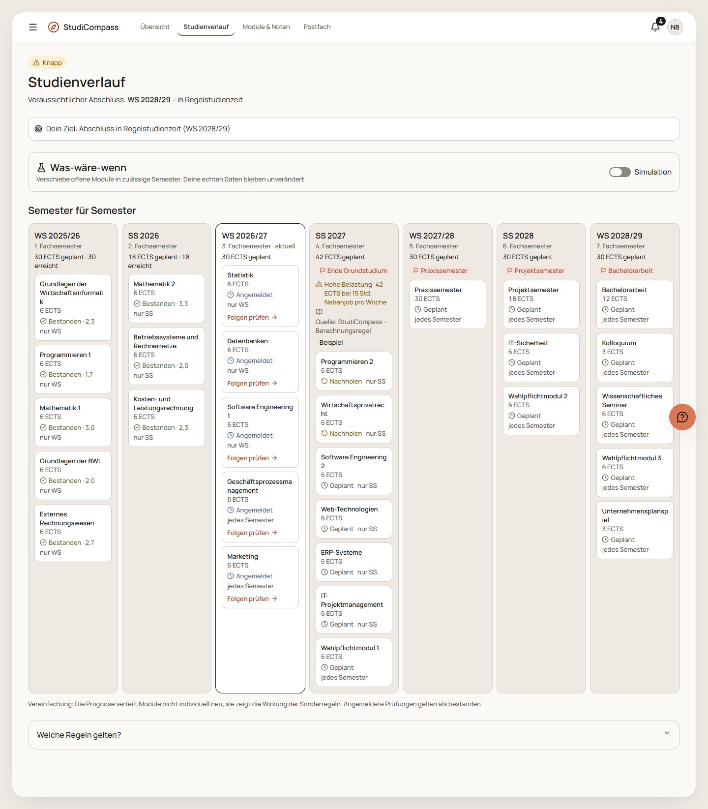
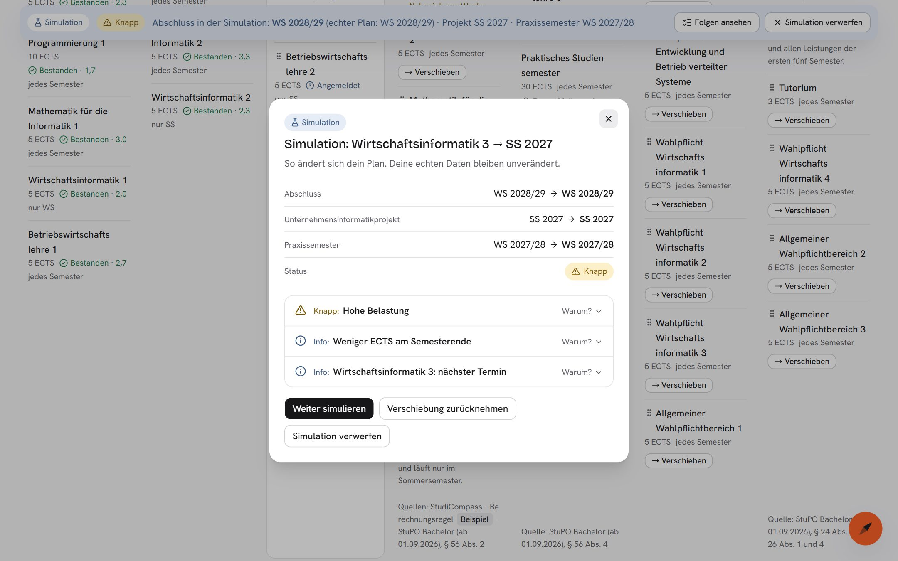

# Wie StudiCompass entstanden ist

StudiCompass ist im Wintersemester 2026/27 im Modul Software Engineering 2 an der TH Mannheim entstanden, als Projekt einer Vierergruppe. Diese Seite zeichnet den Weg nach: von der Frage, was Studierenden bei der Organisation ihres Studiums fehlt, bis zum klickbaren Prototyp und seinen Überarbeitungen.

Der Aufbau folgt dem Double Diamond: Entdecken, Definieren, Lösen, Prototyping. Ein fünftes Kapitel beschreibt die Weiterentwicklung nach der Prüfung: die Anbindung an Moodle. Jede Phase beantwortet dieselben vier Punkte: die Frage, die Methode, das Ergebnis und die Entscheidung, die daraus folgte.

## Auf einen Blick

| Phase       | Frage                                             | Entscheidung                                                                       |
| ----------- | ------------------------------------------------- | ---------------------------------------------------------------------------------- |
| Entdecken   | Was fehlt Studierenden wirklich?                  | Der Studienstand wird das zentrale Element, kein Kalender                          |
| Definieren  | Für wen und für welches Problem?                  | Eine Persona, ein Problem: Folgen werden erst sichtbar, wenn es zu spät ist        |
| Lösen       | Wie lösen wir das Problem?                        | Ein Flow im Zentrum: prüfen, bevor man entscheidet                                 |
| Prototyping | Trägt die Lösung, und wo hakt sie?                | Drei Überarbeitungen nach Teamtest, Rückmeldung zur Gestaltung und Regelwerk       |
| Anbinden    | Trägt das Konzept mit einer echten Schnittstelle? | Moodle direkt aus dem Browser; die Demo bleibt ohne Server, über eine Aufzeichnung |

## 1 Entdecken

**Frage.** Wir wussten, was an der Studienorganisation nervt. Wir wussten nicht, was wirklich fehlt.

**Methode.** Stakeholder-Analyse und Forschungsfragen, danach fünf Interviews (drei davon mit Studierenden der TH Mannheim) und eine Umfrage mit acht Teilnehmenden.

**Ergebnis.** Die Stichprobe ist klein, die Zahlen zeigen Tendenzen:

- 4 von 8 wissen kaum, wie viele ECTS ihnen fehlen.
- Dass Informationen über viele Kanäle verteilt sind, stört (Ø 3,7 von 5).
- Über mehrere Semester plant kaum jemand (Ø 2,1 von 5).
- 8 von 8 organisieren ihr Studium zu Hause, 6 von 8 am Laptop.
- Unsere Annahme „Studierende verpassen Fristen“ hielt nicht: 8 von 8 hatten keine Frist verpasst.

Der zweite Befund kam aus den Interviews: Folgen einer Entscheidung sind nur dort unklar, wo eine Sonderregel greift, etwa bei der Zulassung zum Projekt- oder Praxissemester.

**Entscheidung.** Der eigene Studienstand wird das Hauptelement der Übersicht. Fristen bleiben ein Baustein, aber kein Kalender auf der Startseite.

## 2 Definieren

**Frage.** Für wen bauen wir, und welches Problem lösen wir zuerst?

**Methode.** Persona, Nutzungskontext (Nutzer, Aufgaben, Umgebung) und Value Proposition Canvas.

**Ergebnis.** Die Persona ist Niklas Brandt, 20, 3. Semester, Nebenjob. Er plant kurzfristig, entscheidet unter Zeitdruck eher aus dem Bauch und will bei Antworten wissen, wo sie stehen. Aus dem Canvas ergaben sich fünf Pains und vier Gains; die drei wichtigsten Pains:

1. Informationen sind auf viele Plattformen verteilt.
2. ECTS muss man selbst ausrechnen.
3. Die Folgen von Sonderregeln lassen sich schwer abschätzen.

Das kritische Szenario: Niklas meldet sich am Abend vor der Frist von einer Prüfung ab. Wochen später merkt er, dass sein Plan nicht mehr aufgeht.

**Entscheidung.** Die Problemdefinition lautet: Folgen werden erst sichtbar, wenn es zu spät ist. Dazu kommt eine Gestaltungsregel, die den ganzen Prototyp prägt: **Die App warnt nur, wenn eine Sonderregel greift.** Pauschale Warnungen bei jeder Abmeldung sind durch die Forschung nicht gedeckt und stumpfen ab. Und weil fast alle am Laptop organisieren: Desktop zuerst, der Kernablauf funktioniert trotzdem im schmalen Handy-Browser.

## 3 Lösen

**Frage.** Wie lösen wir das Problem, ohne uns zu verzetteln?

**Methode.** Exposé, User Story Map, UX Flow Chart; danach Moodboard, handgezeichnete Wireframes und der Hi-Fi-Prototyp.

**Ergebnis.** Die Story Map folgt Niklas durch sechs Schritte: einsteigen und Kanäle verbinden, Studienstand erfassen, Entscheidung prüfen, Studium planen, Fragen klären, informiert bleiben. Jede Funktion lässt sich auf einen Pain oder Gain zurückführen:

| Pain oder Gain                         | Funktion im Prototyp                                     |
| -------------------------------------- | -------------------------------------------------------- |
| Informationen verteilt                 | Postfach, das vier Kanäle bündelt und kennzeichnet       |
| ECTS selbst ausrechnen                 | Studienstand mit Ist, Soll, Status und Prognose          |
| Folgen von Sonderregeln                | Folgen-Check vor der Abmeldung, Was-wäre-wenn im Verlauf |
| Antworten auf Sonderfragen dauern Tage | Assistent mit Quelle; sonst vorbereitete Anfrage         |
| Antworten, denen man trauen kann       | Quellenangabe an jeder Aussage zu Regeln und Fristen     |

**Entscheidung.** Ein Ablauf steht im Zentrum und wird vollständig gebaut: Übersicht → Folgen-Check → simulierte Abmeldung → zurück zur Übersicht → Rückgängig. Alles andere wurde priorisiert oder kam auf einen Ideenparkplatz (zum Beispiel echte Anbindung, echtes Sprachmodell, Push-Benachrichtigungen, dunkles Design).

Die Prototyp-Strategie: in der Breite klickbar, im Kern echt gerechnet. Die Oberfläche deckt alle Bereiche ab; Studienstand, Regelprüfung und Folgen-Check rechnen tatsächlich, auf Beispieldaten und ohne Netzwerk. Simuliert sind die Hochschulsysteme, der Assistent (ein vorbereiteter Antwortkatalog, damit er nichts erfindet) und die Abmeldung.

## 4 Prototyping

**Frage.** Trägt die Lösung, und wo hakt sie?

### Aufbau in Meilensteinen

Der Prototyp entstand ab dem 23.10.2026 in Stufen, jede mit einem Tag im Repository:

| Tag                                                          | Datum  | Inhalt                                                     |
| ------------------------------------------------------------ | ------ | ---------------------------------------------------------- |
| [`m0`](https://github.com/lucasstrubel/studicompass/tree/m0) | 25.10. | Konzept und Plan                                           |
| [`m1`](https://github.com/lucasstrubel/studicompass/tree/m1) | 26.10. | Fundament: App-Rahmen, Navigation, Deployment              |
| [`m2`](https://github.com/lucasstrubel/studicompass/tree/m2) | 27.10. | Fachlogik, Daten, Services, Store                          |
| [`m3`](https://github.com/lucasstrubel/studicompass/tree/m3) | 27.10. | Kernablauf durchgängig, Desktop und schmaler Handy-Browser |
| [`m4`](https://github.com/lucasstrubel/studicompass/tree/m4) | 27.10. | Ergänzende Bereiche: Assistent, Postfach, Module, Fristen  |

### Überarbeitung 1: Teamtest (28.10.)

**Methode.** Alle vier Teammitglieder testeten einzeln sämtliche Funktionen, danach sammelten wir die Befunde gemeinsam. Zusätzlich lief eine Inspektion gegen die Designprinzipien aus Apples Human Interface Guidelines.

**Ergebnis.** 23 Befunde aus der Teamrunde. 22 sind umgesetzt, einer liegt bewusst auf dem Ideenparkplatz (eine zweite Persona im 4. Semester). Beispiele:

- Im Studienverlauf stand das Ergebnis einer Verschiebung weit weg von der Aktion. Jetzt erscheint es als Dialog direkt dort; Module lassen sich zusätzlich per Drag & Drop verschieben.
- Die Modulliste war lang. Jetzt sind Semester aufklappbar, dazu kamen Notizen und Kurs-Links je Modul.
- Quellenangaben standen mitten im Inhalt. Jetzt stehen sie als Fußzeile am Ende jeder Karte.
- Eigene Termine fehlten. Jetzt lassen sie sich anlegen, bearbeiten und löschen.

| Vorher                                                                                         | Nachher                                                                                          |
| ---------------------------------------------------------------------------------------------- | ------------------------------------------------------------------------------------------------ |
|  |  |

**Entscheidung: Feedback gegen Forschung abwägen.** Das Team wünschte sich einen Kalender. Die Forschung sagt, dass Fristen der schwächste Pain sind. Der Kalender kam deshalb als zweite Ansicht unter „Fristen“ dazu, nicht auf die Übersicht.

### Überarbeitung 2: eigene Identität (07.11.)

Die Rückmeldung nach der ersten Iteration: zu voll, keine eigene Identität, die Farben wirken überholt. Daraus entstand die Gestaltung „Kurs“ mit Graphit und Mandarine. Ihre Signatur ist die Kurslinie, angelehnt an eine Orientierungslauf-Karte: Dreieck für den Start, nummerierte Kreise für die Semester, Doppelkreis für den Abschluss. Sie trägt den ECTS-Verlauf auf der Übersicht, die Semesterspalten im Studienverlauf und die Schrittanzeige im Onboarding. Gleichzeitig wurde gestrichen: weniger Text, keine Box in einer Box, Listen als Zeilen einer Fläche.

### Überarbeitung 3: echte Regeln (07.11.)

Bis dahin waren Prüfungsordnung und Module erfunden. Seitdem stammen die Regeln aus der Studien- und Prüfungsordnung Bachelor der TH Mannheim (Fassung ab 01.09.2026) und nennen ihren Paragrafen; die Module kommen aus dem Modulhandbuch des Studiengangs. Damit änderte sich das Beispiel des Kernablaufs, das Muster blieb: Programmierung 2 gibt es jedes Semester, aber ohne die Prüfung fehlt die Bachelorvorprüfung, und das Projekt, das sie voraussetzt, läuft nur im Sommer. Ob eine Abmeldung harmlos ist, hängt nicht am Modul, sondern an der Regel dahinter.

Kurz vor der Präsentation am 13.11. folgte noch eine Durchsicht der Gestaltung mit kleineren Korrekturen, unter anderem führt der Folgen-Check seitdem mit den Unterschieden zwischen den Optionen.

## 5 Anbinden

**Frage.** Die Rückmeldung nach der Präsentation: Trägt das Konzept auch mit einer echten Schnittstelle, und lässt sich Moodle als Backend nutzen?

**Methode.** Erst ein Spike, dann Umsetzung in kleinen Schritten. Der Spike lief gegen ein eigenes Moodle mit Beispielkursen statt gegen das der Hochschule: Dort kann man auch die Rolle der Lehrperson spielen, automatisch testen, und es enthält keine Daten echter Personen. Die Entscheidungen stehen als kurze Seiten unter [`adr/`](adr/).

**Ergebnis.**

- Der Browser kann Moodle direkt aufrufen; ein eigener Server ist nicht nötig. Alles, was die App braucht, ist mit dem Zugriffsschlüssel eines Studenten lesbar.
- Lädt die Dozentin eine Datei hoch, meldet Moodle genau diese Änderung. Daraus wurde „Neu in Moodle“: am Modul, im Postfach und an der Glocke.
- Eigene Einstellungen lassen sich in Moodle nicht ablegen, private Dateien schon. Die eigenen Einträge der App liegen deshalb auf Wunsch als eine Datei dort.
- Moodle weiß, ob eine Abgabe eingereicht ist, aber nicht, ob sie als Prüfungsvorleistung zählt. Die App schlägt deshalb nur vor; die Entscheidung bleibt beim Studierenden. Das passt zur Regel aus Phase 2: informieren, nicht lenken.

**Entscheidung: echt, ohne die Demo zu verlieren.** Die öffentliche Demo sollte weiter ohne Server und ohne Kosten laufen. Der Kanal Moodle bekam deshalb drei Datenmodi: Beispieldaten, eine Aufzeichnung echter Antworten in zwei Zuständen (vor und nach den Änderungen der Dozentin) und ein verbundenes Moodle. Die Aufzeichnung läuft durch denselben Code wie die echte Verbindung, und GitHub Actions prüft diesen Code gegen ein echtes Moodle.

Was die Tests dabei fanden, zeigt ihren Wert: Nach einem Neuladen zeigte die Aufzeichnung wieder den Anfangszustand, während die erkannten Änderungen stehen blieben. Und unter der Content-Security-Policy versuchte eine Bibliothek, Code zur Laufzeit zu erzeugen. Beides fiel erst im Browser-Test auf, nicht beim Lesen des Codes.

## Arbeitsweise

- **KI-gestützte Entwicklung.** Den Code hat überwiegend Claude Code geschrieben, in frühen Phasen mit einem zweiten Modell als Gegenprüfung. Konzept, Entscheidungen und Abnahme lagen beim Menschen. Die Regeln, an die sich die Entwicklung hält, stehen offen in [CLAUDE.md](../CLAUDE.md).
- **Ein Prüf-Gate.** Vor jedem Pull Request laufen Typprüfung, Linting, Unit-Tests und Build (`npm run check`), dazu End-to-End-Tests des Kernablaufs mit Maus und nur per Tastatur.
- **Kleine Schritte.** Ein Branch und ein Pull Request je Änderung; `main` ist immer auslieferbar und wird automatisch veröffentlicht.
- **Barrierearm von Anfang an.** Kontraste werden per Test geprüft, der Kernablauf funktioniert per Tastatur, Bewegung respektiert die Systemeinstellung.

## Grenzen

- **Nur das Team hat getestet.** Wer ein System gebaut hat, stolpert anders als jemand aus der Zielgruppe. Ein Test mit unabhängigen Studierenden steht aus, auch für die neuen Moodle-Funktionen; die Aufgaben dafür liegen vor. Automatisch geprüft ist nur, was eine Maschine prüfen kann: Barrierefreiheit nach WCAG 2.1 A und AA mit axe. Auch gemessen wurde nichts: Ob Aufgaben nach den Überarbeitungen schneller gelingen, ist nicht belegt.
- **Kleine Stichprobe.** Fünf Interviews und acht Umfrage-Antworten zeigen Tendenzen, keine repräsentativen Ergebnisse.
- **Eine echte Schnittstelle von vier.** Moodle ist angebunden, geprüft gegen ein eigenes Moodle mit Beispielkursen. Ob das Moodle einer Hochschule den Zugriff freigibt, entscheidet die Hochschule; POS, Mail und Website sind weiter simuliert, und die rechtliche Seite eines Betriebs ist offen.
- **Der Assistent ist kein Sprachmodell.** Er ordnet Fragen einem vorbereiteten Katalog zu.

Wer tiefer einsteigen will: Die ausführlichen Arbeitsdokumente (Konzept, Testplan, Befundliste) liegen in der Git-History bis zum Commit [`c0447ef`](https://github.com/lucasstrubel/studicompass/commit/c0447ef), das [Präsentationskonzept](praesentation/konzept.md) im Repository.
